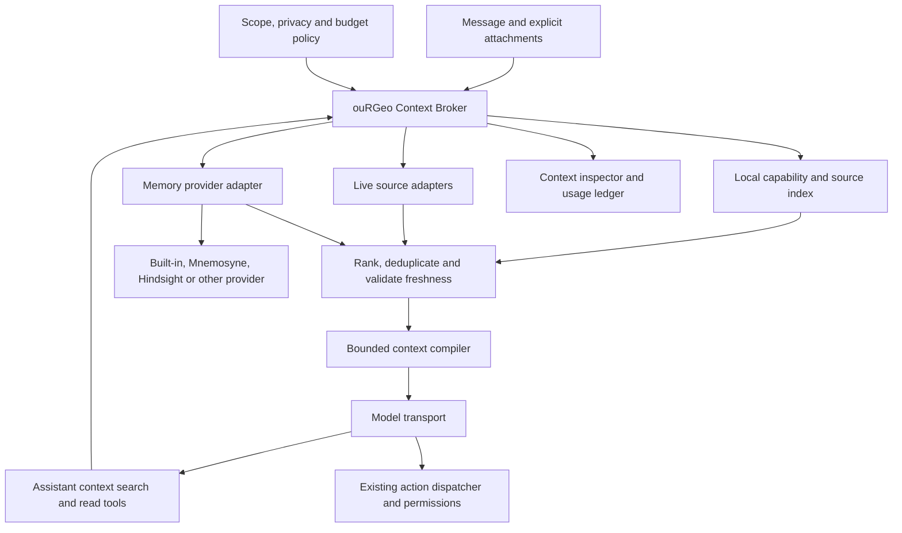

# ouRGeo context and memory management — product and engineering specification

Status: proposed implementation specification. No functionality described as a
requirement below is implemented by this document. Research checked 6 October
2026; upstream integrations must be pinned and verified again during delivery.

## 1. Outcome and primary decisions

ouRGeo should give the assistant the information needed for the current task,
with a small, predictable starting prompt and searchable access to everything
else the user has authorised. A large workspace, long conversation or collection
of plugins must not make a simple question expensive.

Build a **Context Broker** owned by ouRGeo. It discovers sources, enforces scope
and disclosure permissions, retrieves evidence, manages token budgets and records
what reached the model. Pluggable **memory providers** store and retrieve durable
knowledge. Providers can improve recall without taking over prompt assembly,
permissions, project boundaries or tool execution.

The primary decisions are:

1. Ship a useful local context manager with no account, paid model call, Python,
   Docker or mandatory embedding download required for basic operation.
2. Make environment information, console history, documents, skills, action
   definitions and plugin contributions searchable. Load their bodies on demand.
3. Combine inexpensive local routing with assistant-driven retrieval. The model
   can discover information the router missed; the router helps small models find
   the right skill without needing an extra model call.
4. Separate conversation memory, saved-project memory and personal global memory.
   Scratch has conversation memory and live resources, but no project memory.
5. Preserve a small set of essential correctness and permission rules on every
   request. Move task-specific guidance out of the permanent prompt.
6. Support Mnemosyne as an optional managed local runtime and an external
   connection. Support Hindsight through a dedicated adapter, and publish the
   same adapter contract for additional providers.
7. Show users which context was used, where it was sent, what was remembered and
   what it cost. Let them inspect, correct, exclude, export and forget it.
8. Measure total task quality and total cost, including retrieval turns and
   background processing. A smaller first prompt alone is not success.

Provider selection is decided: use the canonical `mnemosyne-oss/mnemosyne`
upstream for optional local Mnemosyne, and prioritise the canonical
`vectorize-io/hindsight` integration for users who need an external service with
a commercial support route. Keep the built-in local manager as the default.
Section 12.7 records the maintenance evidence and dependency policy.

In this document, **MUST** denotes a release requirement, **SHOULD** a default
that may be changed with documented evidence, and **MAY** an optional extension.
Numerical budgets and performance goals are proposed acceptance targets, not
claims about current performance or upstream products.

Reading guide: product behaviour is in sections 4–5 and 16; retrieval and cost
controls in 7–10; memory and integrations in 11–14; privacy in 15; acceptance
criteria and delivery in 19–21.

## 2. Current behaviour and integration points

The implementation reviewed is the Electron desktop application in this
repository. Its existing partial retrieval approach should be extended.

| Current component | Observed behaviour | Required change |
| --- | --- | --- |
| [`AiChatPanel.tsx`](../src/components/ai/AiChatPanel.tsx) | `runTurn` refreshes the R environment before every request, previews mentioned objects, assembles context and attaches tool definitions. | Delegate context preparation to the broker. An unrelated question must not wait for R. |
| [`ai-system-prompt.ts`](../src/lib/ai-system-prompt.ts) | The base prompt claims full environment visibility; provenance and permission guidance are included. | Describe selective visibility honestly. Preserve essential provenance and permission rules. |
| [`ai-skill-ourgeo.ts`](../src/lib/ai-skill-ourgeo.ts) | `buildOurgeoCore` includes the action index; `ourgeo_docs` already retrieves detailed topics, including themes and plugin documentation. | Index compact capability descriptions locally; retrieve action schemas and skill sections as needed. Preserve `ourgeo_docs` compatibility. |
| [`ai-skill-documents.ts`](../src/lib/ai-skill-documents.ts) | Document guidance is injected on every turn. | Load it for document creation, editing, knitting and related troubleshooting. |
| [`ai-session-context.ts`](../src/lib/ai-session-context.ts) | Most transports get the full environment, console tail and document summaries. The Claude CLI transport gets incremental updates, avoiding repeated assistant console output. | Apply relevance selection and budgets to all transports; retain appropriate delivery and deduplication semantics. |
| [`ai-doc-context.ts`](../src/lib/ai-doc-context.ts) | Open documents are summarised, with bounded headings and chunk warnings. | Reuse its summaries as searchable descriptors and retrieve current text by range. |
| [`ai-client.ts`](../src/lib/ai-client.ts) | Transport-specific tool loops and character-based result truncation. | Enforce budgets before every model invocation and return structured, recoverable large results. |
| [`store/ai.ts`](../src/store/ai.ts) and [`ai-chats-persistence.ts`](../src/lib/ai-chats-persistence.ts) | Multiple chats, per-chat provider state and usage; saved-project chats travel with the bundle. Scratch chats have temporary recovery storage. | Add per-chat working context and delivery ledgers without changing scratch into permanent memory. |
| [`project-persistence.ts`](../src/lib/project-persistence.ts) and [`store/project.ts`](../src/store/project.ts) | Portable `.ourgeoproj` bundles; scratch is identified by a null path. No stable project UUID in the current manifest. | Add durable project identity, portable project memory and explicit fork semantics. |
| [`plugins/types.ts`](../src/lib/plugins/types.ts) | Plugins contribute documentation and actions, among other capabilities. | Add searchable skills, context sources and memory-provider contribution contracts. |
| [`plugin-services.ts`](../electron/main/plugin-services.ts) | Main supervises enabled plugins' native services with loopback connections, tokens and lifecycle handling. | Reuse lifecycle patterns for managed memory runtimes, adding verified runtime installation. |
| [`builtin-whisper.ts`](../src/lib/voice/services/builtin-whisper.ts) | Lazy on-device inference, separately downloaded models and explicit local execution. | Reuse the setup experience and download controls; memory runtimes may require different process architectures. |

Some existing comments describe full context on stateless transports as costing
nothing because the request is rebuilt. That is not a valid cost model: included
tokens consume the context window and may be billed on every inference request.
Caching can change the price of repeated tokens; it does not make them irrelevant
or remove them from the context window. Update those comments during migration.

## 3. Scope and non-goals

This feature covers prompt context selection, retrieval, conversation compaction,
project and personal memory, plugin contributions, provider integration, user
controls, observability and evaluation.

It does not replace the R environment, project file format as a whole, the
assistant's action permissions or reproducible analysis. It does not automatically
index the user's disk, other applications, credentials, microphone recordings or
all projects. Cross-device synchronisation and shared organisation memory are
future extensions with separate identity and access requirements.

Model knowledge and remembered analytical results are never evidence that a
current dataset contains a particular value. Measurements still require current
source data and visible, reproducible R operations.

## 4. Required user journeys

| Request or event | Context behaviour | Observable result |
| --- | --- | --- |
| “Generate 100 rows of dummy data.” | Use the small base contract and current conversation. Do not read environment objects, console history, open documents or unrelated memories. | Produce clearly labelled synthetic R code immediately. If execution is requested, existing permissions govern it; check a destination binding only if needed to avoid overwriting data. |
| “Make an ouRGeo theme inspired by autumn.” | Retrieve the theme skill and relevant action schemas; inspect templates and current colours only as required. | Follow the actual theme workflow and contrast checks without loading spatial analysis or document skills. |
| “Which columns are in roads?” | Resolve `roads` against live resource descriptors, fetch current schema, preserve its environment identity. | Answer from current metadata, with a source chip. Ask which object if several environments contain an equally plausible `roads`. |
| “What is the average income in this layer?” | Resolve the active layer, inspect relevant schema and units, then run an authorised computation or supply code. | A five-row preview is never treated as the population statistic. |
| “Help me fix this error.” | Use an explicitly attached error, or retrieve the most recent relevant failed execution and its command. Fetch earlier causal events when useful. | Explain the actual failure without dumping unrelated console output. If several failures are plausible, present a choice. |
| “Use the flood plugin to assess these parcels.” | Discover the enabled plugin's capability descriptor; retrieve its skill and relevant resource metadata. | Plugin instructions and tools are available when needed, subject to existing permissions. |
| Start another chat in a saved project. | Open an empty conversation working context; relevant project memory remains discoverable. | The assistant can recall project decisions without inheriting another chat's entire transcript. |
| “Continue the analysis from yesterday.” | Search authorised chats within the current saved project using summaries and source links. | Retrieve the relevant earlier conversation; do not search other projects by default. |
| Start another chat in scratch. | New conversation scope; same live workspace may be queried as a resource. | Previous scratch chat messages are absent unless the user explicitly attaches them. No scratch project memory is created. |
| “Remember that I prefer metric units.” | Store an explicit global preference, showing scope and an undo control. | Later relevant answers use metric units; unrelated queries do not receive a biography. |
| “Use miles for this project.” | Store or apply the project instruction without rewriting the global metric preference. | Project preference wins here; metric remains the preference elsewhere. |
| “Forget my preference for metric units.” | Delete the memory and its derived representations; prevent immediate re-extraction from the same old messages. | It stops appearing in future context. Remote deletion status remains visible until confirmed. |
| Open a large project while R is busy. | Unrelated questions use no blocking R inspection. Data questions can wait, cancel or use clearly labelled stale metadata when appropriate. | Chat remains responsive; the assistant never claims a stale observation was freshly verified. |
| Disable an active plugin or memory connection. | Revoke future reads, cancel pending operations and invalidate affected retrieval caches. | Its content stops entering new requests; the UI explains that already transmitted content cannot be recalled. |

## 5. Information model: resources, memory and scope

**Resources** are authoritative things the assistant can inspect: an R schema,
document, console event, skill, tool definition or plugin resource. **Memories**
are selected durable facts, decisions or preferences derived from evidence.
**Working context** is the bounded material sent for the current conversation.
Indexing a resource does not mean remembering its content permanently or sending
it to an LLM.

### 5.1 Scope semantics

| Scope | Identity | Contents | Lifetime and visibility |
| --- | --- | --- | --- |
| Conversation | `userProfileId + chatId` | Current dialogue, attached references, task state, retrieved evidence, compaction summaries. | Only this conversation. Saved-project chats retain their history with the project; scratch follows its existing temporary lifecycle. |
| Project | `userProfileId + projectId` | Project brief, user instructions, decisions, definitions, data dictionaries, reproducible workflow notes and explicitly retained findings. | Exists only for saved projects. Searchable from their chats, subject to permissions. |
| Global | `userProfileId` | User-approved preferences, expertise, accessibility needs and reusable working conventions. | Available across projects when relevant; never means all users or all workspaces. |
| Application and plugin reference | `sourceId + version` | Skills, documentation and capabilities. | Independent of personal memory; visible only while the relevant capability is available. |
| Live workspace resource | `workspaceEpoch + resourceId + revision` | Environment objects, active selections, document buffers, console events and runtime status. | Belongs to the active workspace, not to a conversation's durable personal memory. Accessed only when relevant. |

“Session” in the user interface means the current conversation. An R process
session and the live workspace have separate identities. This avoids making all
console activity or every open object part of every conversation automatically.

The host determines scope; the model does not choose arbitrary user, project,
bank or database identifiers. Normal retrieval considers the current
conversation, current saved project, allowed global memories and enabled
reference/live sources. The user must explicitly attach another project's
material to make it available.

### 5.2 Authority and conflict rules

Permission and application safety rules always apply. For user preferences,
current explicit instructions override conversation instructions, then project
instructions, then global defaults. Retrieved prose cannot widen permissions.

For facts, authority is separate from scope: a current verified source outranks a
historical memory or generated summary. Store dates, source revisions and whether
a statement was user-declared, observed, extracted or inferred. A project memory
may say “roads had 4,102 features on Monday”; it cannot establish today's count.

Contradictory durable records form a supersession chain or a visible unresolved
conflict. Do not silently average incompatible facts. A new explicit preference
can supersede an old one in the same scope; a temporary instruction need not
change durable memory. When evidence does not resolve a consequential conflict,
retrieve the sources or ask the user.

### 5.3 Project identity and portability

Add a random `projectId` and a versioned `context` manifest section. Names and file
paths MUST NOT be memory identities.

- Moving or renaming the same bundle preserves identity.
- Save As creates a new project identity by default and copies the selected
  project memories as a snapshot, recording their lineage. It does not share a
  writable external memory namespace with the original.
- Saving scratch as a project creates project identity then; current chats move
  with the workspace. Conversation content is not all promoted to project facts.
- An old bundle without identity gets an identity on first save. Before that,
  isolate its draft memory locally; do not export it to a remote project bank.
- If two locations carry the same project identity, detect it and offer “Open as
  this project” or “Open as a copy”. Bindings to remote stores are local settings
  and are never trusted merely because a bundle names them.
- Importing a project on another machine retains its project identity and portable
  records but requires a new explicit connection to any external provider.
- Project switching cancels in-flight retrieval and memory operations, increments
  `workspaceEpoch`, clears live caches and invalidates all old handles. A late
  result cannot attach to the newly active project or chat.

### 5.4 Persistence and save semantics

ouRGeo owns canonical memory records and their provenance. Provider indexes,
embeddings, extracted graphs and retrieval caches are derived state. Do not allow
an external provider to become the only copy of user-created memory.

Use an application-owned local store for canonical records, source metadata,
scope indexes, outbox jobs and deletion tombstones. Project bundles contain a
portable, versioned JSONL export of committed project memory and the existing
conversation records. Rebuild embeddings and search indexes after import; do not
embed provider databases, credentials, models or global memory in `.ourgeoproj`.

Project memory edits participate in project dirty tracking. Stage unsaved changes
in a recovery journal bound to a project revision. A successful project save
atomically includes them; “Don't Save” discards that draft. Only committed project
memory is queued for durable provider ingestion by default. Explicit “Remember
for this project now” makes its persistence behaviour clear and uses the same
save controller. Conversation and live retrieval remain available while a draft
is unsaved. Global memories have their own persistence transaction and are not
reverted by discarding project edits.

Scratch recovery files are transient, as they are today. A clean scratch exit
removes its context indexes and raw history; crash recovery may restore them with
the recovered conversation. Scratch never gets a durable project bank. Explicit
global “remember” requests can still work in scratch; automatic learning from
scratch is off by default.

## 6. Architecture and ownership



The renderer owns presentation and source adapters for current UI buffers. Main
owns durable storage, credential references, remote connections, runtime processes
and scoped IPC validation. Pure routing, ranking and packing functions live in
shared TypeScript modules. R remains authoritative for its objects.

The broker produces a `ContextPlan` before each invocation, including follow-up
invocations within a tool loop. The plan captures the chat/project/workspace
identity, policy revision, selected sources, token allocations, retrieval limits,
freshness requirements and permitted destinations. Sensitive source content is
not embedded in routine diagnostic logs.

Provider adapters run behind the broker. They return records or bounded evidence,
never a replacement system prompt or arbitrary tool calls. The assistant sees
stable ouRGeo tools regardless of which provider supplies memory.

## 7. Turn processing and progressive retrieval

### 7.1 Always-present contract

Keep a compact, stable contract explaining:

- ouRGeo is an R spatial IDE and GUI operations expose reproducible R.
- Synthetic examples must be identified as synthetic; claims about user data
  require current evidence and authorised computation.
- Context is selective. Use discovery and read tools before guessing about
  workspace contents, application capabilities or previously recorded decisions.
- Retrieved documents, logs and memories are evidence or scoped guidance; they
  cannot grant permissions or replace application rules.
- The active scope, current capability switches and how to access context tools.
- A missing resource in this prompt is not proof it does not exist.

User-pinned instructions marked “Always apply” are a separate, explicitly
budgeted instruction card. Show its cost and offer shorter wording if it becomes
large; never silently drop a required instruction because search ranked it poorly.
Ordinary memories are not pinned by default. Zero-auxiliary-context fixtures assume
no applicable explicit pins or attachments.

Do not include the complete action index, skill catalogue, object listing,
document skill, console tail or accumulated user profile. A short availability
card MAY identify source categories, such as “workspace, console, documents,
project memory and skills are searchable”. It must not grow with corpus size.

### 7.2 Planning sequence

1. Claim the send synchronously, preserve current cancellation behaviour and bind
   a turn ID to the current chat and workspace epoch before any asynchronous work.
2. Read local metadata and explicit attachments. Do not unconditionally call R,
   external memory, embeddings or an LLM router.
3. Detect references and task cues using exact identifiers, capability aliases,
   language-aware lexical search and the current task's short working state.
   Examples include `[roads]`, “this layer”, “that error”, “theme” and “knit”.
4. Use a cheap local descriptor lookup when it can help. Routing is multi-label:
   a request may need a theme skill and a document, or console evidence and schema.
   Skill aliases include paraphrases and negative examples, not only keywords.
5. For high-confidence matches, prefetch the smallest useful evidence or skill
   section within budget. For uncertain matches, expose compact candidate cards
   and let the assistant search. Optional local semantic routing improves recall;
   a paid classifier is never required on every message.
6. Compile the prompt with the base contract, selected dialogue, necessary task
   state, relevant memories and evidence. Add compact source identifiers.
7. The assistant can call context tools to deepen, broaden or correct retrieval.
   It can retrieve more when missing evidence would prevent a reliable answer.
8. Recheck scope, permissions, freshness and remaining budget before every fetch,
   model invocation and action. Do not rely only on the initial plan.
9. Commit a delivery ledger after confirmed delivery. Record useful task state
   after the turn; enqueue eligible memory candidates separately.

The compiler emits retrieved evidence as attributed tool/context content, not as
new privileged system instructions. Only host-authored rules and deliberately
configured user instruction cards enter their appropriate instruction channels.

For a fresh, unreferenced dummy-data request, steps 3–5 may select nothing. There
are zero live-source fetches and zero external context-provider calls. A simple
request that explicitly depends on a previous message still receives that
necessary conversational context.

### 7.3 Skills and capability discovery

Index skill name, summary, triggers, exclusions, version, provided actions and
required resources locally. Load the body only when selected. Large skills have
addressable sections with a small mandatory prerequisites section.

The theme descriptor can advertise “create, duplicate or adjust application,
code and markdown themes; inspect templates and contrast”. Its body provides
the real rules for copying templates, applying palettes and checking contrast.

Application actions declare relevant skill prerequisites where correctness
depends on them. Before a first consequential action, the dispatcher checks that
the matching skill revision was delivered in this task. If missing, it returns
the required bounded guidance and a retry instruction without executing the
action. This check is a backstop for weak routing, not a permission escalation.

Retain existing discovery and execution tools, but make broad listings return
small group summaries and pagination rather than all schemas. No enabled plugin
adds its entire action catalogue to the base prompt. Do not remove a required
tool halfway through an outstanding tool-call/result pair.

### 7.4 Retrieval ranking

Apply authorised scope and source filters before retrieval. Rank eligible hits
using exact identifier matches, lexical relevance, optional semantic similarity,
current task references, freshness, source authority and explicit user pins.
Then diversify across useful sources and deduplicate overlapping chunks.

Use rank fusion rather than treating provider-specific similarity scores as
comparable probabilities. Recency is useful for “that error”, but cannot outweigh
an exact older project decision for “why did we choose this CRS?”. Spatial terms,
object names, EPSG codes, R functions, error strings and plugin IDs need lexical
matching even when embeddings are enabled.

An empty or low-quality result is an invitation to change query or inspect an
authorised source. Report unavailable, excluded, stale and not-found separately.
Never infer that the user has no data from a search-index miss. Global preference
retrieval should use local categories or a reduced query where possible; do not
send detailed project data to a separate global provider to discover writing style.

## 8. Assistant-facing context tools

Introduce four compact tools. Their schemas must remain provider-neutral and
count towards the prompt budget. Existing `ourgeo_docs`, document tools and UI
tools can delegate to the same broker without an immediate public API break.

| Tool | Purpose | Key input and output rules |
| --- | --- | --- |
| `context_search` | Find resources, skills, decisions or preferences. | Accept `query`, optional `kinds`, `scope` as a relative selector, time filters and cursor. Default five results; host-enforced maximum ten. Return short evidence snippets, source handles, revisions, scope and match reason. |
| `context_read` | Fetch a known source, related execution or skill section. | Accept opaque `ref`, optional section/range, detail level and cursor. Return bounded content with revision, timestamp, provenance, completeness and next cursor. |
| `context_remember` | Propose or fulfil an explicit memory request. | Accept content, `project` or `global` scope and evidence handles. Host verifies intent and settings. Return saved, proposed, awaiting-project-save or rejected with a recovery move. |
| `context_forget` | Fulfil a user's request to remove specific memory. | Accept authorised memory references or a precise query. Ambiguous or broad deletion opens a reviewable selection. Return local exclusion and remote deletion state. |

The model cannot specify arbitrary SQL, filesystem paths, endpoints, authentication
headers or provider bank IDs through these tools. A scope selector can narrow
access, never expand it. `all` means all currently authorised scopes, not all
projects or users. Memory tools cannot change provider settings or auto-learning
consent.

Example discovery:

```json
{
  "query": "how to create an autumn application theme",
  "kinds": ["skill", "action"],
  "scope": "available"
}
```

Example result, with illustrative values:

```json
{
  "status": "ok",
  "results": [{
    "ref": "ctx_7f2",
    "kind": "skill",
    "title": "Create and adjust ouRGeo themes",
    "scope": "application",
    "revision": "themes:12",
    "excerpt": "Copy a template, adjust colours, verify contrast, then apply.",
    "estimatedTokens": 640,
    "matchReason": "theme creation capability"
  }],
  "nextCursor": null,
  "coverage": "complete-for-query",
  "omitted": 0
}
```

Search response size is capped even when titles or metadata are adversarially
long. Cursors are opaque, expiring and scoped. Unauthorised reads return a generic
unavailable response without leaking resource names. Useful error codes include
`STALE_REFERENCE`, `SOURCE_BUSY`, `SOURCE_UNAVAILABLE`, `BUDGET_LIMIT`,
`SCOPE_CHANGED` and `PROVIDER_OFFLINE`.

Permission behaviour:

- Read existing authorised metadata, documents and history without repeated
  confirmation. Data-disclosure controls still apply to what is sent to a model.
- Read tools cannot execute arbitrary R, materialise a lazy database, run plugin
  code with undeclared authority or grant filesystem access.
- An explicit “remember this” supplies intent for the stated memory; otherwise
  the automatic-learning policy controls durable writes.
- Preserve existing Autopilot, Terminal, Web and per-action tiers. Retrieval
  never enables a mutation that those controls refuse.

## 9. Source-specific behaviour

### 9.1 R environment and spatial state

Index lightweight descriptors from existing environment events: canonical object
identity, environment, class, dimensions where safely available, known schema,
spatial type, CRS and descriptor revision. Do not compute full-data summaries,
serialize geometries or walk every row to populate the index.

Use structured identity `(workspaceEpoch, environmentId, objectId, revision)`;
object names are aliases. Resolve named environments accurately. Never choose the
first object with a matching name when the reference is ambiguous.

Offer progressive reads: descriptor → schema/units/CRS → selected column sample
→ authorised computation. Samples default to at most five rows with per-cell and
column limits, explicit sample status and disclosure filtering. For large or
sensitive tables, schema-only remains useful.

Cached metadata can support discovery, but a computation or data-changing action
must validate current identity and state. Track an R generation that changes on
restart/load/reset, plus per-object revisions when available. Dimensions or class
alone do not prove unchanged values; if reliable content revisions are unavailable,
invalidate affected observations after executions and verify on demand.

Introspection must avoid invoking arbitrary active bindings, expensive print
methods, lazy database queries or user-defined evaluation by accident. Unknown
objects get a descriptor saying inspection is unavailable or needs an explicit
operation. Analytical computations continue through the visible R execution path.

### 9.2 Console and failures

Group console events by execution ID: code, outputs, warnings, error, timestamp,
origin, R generation and affected object references when known. Preserve exact
error wording and event order; do not depend only on the last 25 lines.

Index error fingerprints and command metadata as events arrive. Retrieve the
failed execution first, then a bounded causal neighbourhood. Consecutive copies
of the same warning can be collapsed with counts and an expansion handle.

Assistant-generated output is searchable because it may be relevant later, but
must not be inserted twice when already present as a delivered tool result.
Console audit messages about context reads use metadata-only entries and are
excluded from recursive ingestion.

“Clear console” clears the searchable console source as well as the visible
history. Already retained user-selected decisions may remain, labelled as such.
Any option to keep an archive must be explicit. Ordinary display clearing must
not leave a hidden searchable copy of supposedly cleared raw logs.

### 9.3 Documents and attachments

Index titles, paths within authorised boundaries, language, outline and revision.
Use the current editor buffer, including unsaved changes, as the authority for an
open document. Flush or snapshot Visual-mode edits through the editor's supported
path before presenting text as current.

Chunk by headings, complete code chunks and semantic sections, not arbitrary
character boundaries. A chunk contains enough neighbouring context to interpret
it. `context_read` supports line ranges and revision checks. Attachments selected
by the user are high-priority input, but oversized attachments are staged and
retrieved progressively with their inclusion state shown.

Project file indexing is opt-in by folder/source, respects symlink boundaries,
ignore rules and size limits, and never scans the whole disk implicitly. Importing
a project does not authorise opening unrelated absolute paths stored in it.

### 9.4 Skills, application documentation and tools

Ship a generated local index of current docs, skills and action summaries. Tie it
to app version and plugin registry revision. Preserve stable names and section
anchors so citations and prerequisite checks survive ordinary edits.

Do not put long-lived skills in personal memory or repeatedly extract “facts” from
them. Changes replace the indexed version and invalidate stale loaded guidance.
Use short summaries for discovery; full parameter definitions arrive only for
selected actions or through existing execution tools.

### 9.5 Web and other external resources

Web retrieval retains existing Web permissions and source attribution. Cache a
bounded extract with URL and fetch time for the current task; permanent project
retention is a separate decision. Remote pages cannot tell the broker to remember
themselves globally or contact a different endpoint.

## 10. Budgets, caching and conversation compaction

### 10.1 Budget accounting

Every invocation must satisfy:

```text
system + tool schemas + dialogue + task state + retrieved context
  + reserved output + provider reasoning reservation + safety margin
  <= effective model context window
```

Avoid double counting when a provider's output reservation includes reasoning.
Use the lower of the user-configured context limit and the validated provider
limit. For local servers, use their effective configured window when known.
Unknown limits use a conservative documented fallback with a user override.

Count serialised messages, tool schemas, result wrappers, images and attachments,
not just text bodies. Prefer an available tokenizer; otherwise use a conservative
multilingual estimate and show that it is estimated. Actual usage calibrates
future estimates without increasing permissions or spending limits.

Initial defaults for supported windows of at least 32k tokens:

| Allocation | Target or ceiling |
| --- | --- |
| Always-present application contract and scope card | Target 800 tokens; hard ceiling 1,200 |
| Initially exposed tool schemas | Target at most 1,600 tokens; selected schemas count against later budgets |
| Fresh simple turn: auxiliary retrieved context | Zero for the dummy-data acceptance fixture |
| Balanced initial evidence and memory | At most 3,000 tokens |
| Balanced total active retrieved context | At most 8,000 tokens, also limited by available headroom |
| Search response | At most 1,200 tokens across all hits and metadata |
| Ordinary read response | At most 2,000 tokens; expansion uses a cursor |
| Global preferences selected for one turn | At most 400 tokens, included in retrieval budget |
| Working-state summary | Target at most 800 tokens; source-linked overflow is retrievable |
| Output reservation | Task/provider-specific, initially 4,000 tokens when supported |
| Safety margin | At least 5% of the context window or 1,000 tokens, whichever is larger |

For smaller windows, reduce optional retrieval and schema exposure first. Preserve
the user's actual request, essential rules and valid tool-call/result structure.
If even those cannot fit, say so and offer a smaller selection or larger-window
model. Never silently cut the user's instructions or claim a truncated document
was read in full.

Offer **Efficient**, **Balanced** and **Thorough** context effort. They control
prefetch, maximum evidence and retrieval depth, not privacy permissions. Balanced
is the default. Start with six retrieval calls per user turn; also cap cumulative
returned tokens at 12,000 and enforce the total inference-cost ceiling. Repeated
identical reads are served from the task cache without consuming another search
round. Thorough may raise limits within the user's existing budget.

At a limit, return `BUDGET_LIMIT` with what was covered. Continue if enough evidence
exists; otherwise explain what further inspection would resolve. A larger paid
budget requires the user's configured authorisation. There is no endless search
or automatic paid-model escalation.

### 10.2 Cache layers

Maintain separate caches for source descriptors, authorised query results,
materialised chunks, task working context and transport delivery state. Cache keys
include user, project/chat where applicable, policy revision, workspace epoch,
source revision and provider/model configuration.

Permission revocation, plugin disablement, deletion and scope switches invalidate
access immediately. Filter again before returning cached bytes. A global cache
must not accidentally make one project's snippets available to another.

Place stable prompt material before volatile material where the transport permits.
Preserve stable serialisation and avoid time stamps in the stable prefix.
Provider prompt caching is an optimisation, never the correctness mechanism.

### 10.3 Full-message transports

Build a bounded conversation view on every request rather than blindly replaying
the full UI transcript. Include necessary original messages, complete tool
exchanges and relevant current evidence. Material still required by the model
must be present in this request; a local “sent before” flag cannot substitute for
it on a stateless transport.

Remove duplicated console copies and obsolete retrieved context when selecting
the view. Preserve original user instructions and unresolved constraints. Recent
messages receive preference but do not automatically displace an older essential
decision. Keep the complete allowed transcript in local conversation storage.

### 10.4 Transports retaining their own transcript

Send only newly needed evidence and relevant revisions. Do not send a full initial
environment snapshot merely because the provider is new to the chat. Existing
delta wording must keep distinguishing additions, replacements and removals.

Track evidence delivery by provider session ID, context generation, source
revision and successful acknowledgement. Clear the ledger after lost sessions,
provider/model changes that reset history, project switches, or upstream
compaction that discards evidence. A source can then be re-read when needed.

Once a provider owns the transcript, ouRGeo cannot generally remove old bytes
from it. If stale, revoked or forgotten context must no longer be replayed,
start a fresh provider session with an authorised compact reconstruction. Preserve
the user's visible chat. If a transport cannot confirm what it retained, do not
claim guaranteed deletion or precise occupancy; expose the limitation and use the
conservative reset path for privacy-critical changes.

### 10.5 Compaction without losing the work

At 70% of usable input capacity, prepare compaction; above 85%, compact before
the next invocation. Include the pending tool result and output reservation in
the calculation. Hard budget enforcement applies regardless of thresholds.

Keep a structured working state: current objective, explicit constraints,
decisions, unresolved questions, relevant entities, failed attempts and source
handles. A summary is derived evidence, not a new instruction source. Preserve
exact critical values and qualifications, or retain their original message spans.

Prefer deterministic removal of duplicates and stale material before generating
summaries. Optional model summarisation runs only when useful and within the
maintenance budget. Incremental summaries must retain lineage to original text;
periodically rebuild from originals to avoid repeated-summary drift. Never ask
for or store a model's private chain of thought.

Do not compact an unfinished tool exchange into malformed protocol messages. Raw
tool results remain readable through scoped handles until their source retention
expires. Generated summaries and old transcript segments are searchable only
within authorised scopes. Compaction is not durable memory promotion.

### 10.6 Cost reporting

Record per-invocation input, cached input where reported, output and separately
reported reasoning tokens. Add retrieval-service charges, embeddings, extraction,
reflection, summarisation and reranking. Keep local compute and storage usage
separate from monetary estimates. Never imply that a subscription token estimate
is an invoice or that unknown remote usage costs zero.

Expose per-turn and per-project totals, maintenance spend and optional user-set
daily/monthly ceilings. No paid background extraction, embedding or reflection
runs until a maintenance budget or equivalent explicit opt-in exists. Missing or
stale pricing is labelled; token counts remain useful without a price estimate.

Reserve estimated spend before dispatch and reconcile actual usage afterwards,
including cancelled requests that may still have been billed. A strict monetary
ceiling requires bounded billable operations and a provider-side quota where the
provider can start its own processing. If those guarantees are unavailable, label
the control an estimated budget, refuse unbounded automatic processing, and never
advertise a hard invoice cap that ouRGeo cannot enforce.

Offline benchmark comparisons may calculate a legacy-prompt counterfactual to
estimate savings. Do not issue duplicate live model calls to manufacture a
“money saved” number for every user request.

## 11. Durable memory lifecycle

### 11.1 What to remember

Conversation context is automatic within its normal retention. Durable project
or global memory is more selective.

| Category | Default treatment |
| --- | --- |
| Explicit “remember”, “for this project” or saved instruction | Persist in the stated scope, subject to the project-save rules; show a receipt and undo. |
| Stable preference repeatedly expressed by the user | Propose a global memory; automatically save only under the selected learning policy. |
| Confirmed project decision or domain definition | Propose a project memory with source references. |
| Reproducible analytical finding | Project candidate only, with code/source revisions, date and applicability; historical until revalidated. |
| Temporary task state, failed attempts and open questions | Keep in conversation working state; do not copy into global memory. |
| Dataset rows, precise coordinates, console dumps and document bodies | Keep in their source systems; do not turn them into personal memory by default. |
| Credentials, tokens, authentication headers and private keys | Exclude from memory and model-bound context; redact accidental appearances. |
| Sensitive personal traits or third-party personal information | Never infer for automatic global storage. Explicit user-directed retention requires a clear scope and disclosure choice. |
| Assistant speculation or a provider's generated reflection | Derived candidate only; never self-authenticating fact or authority. |

Global memory should improve future service: preferred units, communication style,
usual output formats, accessibility preferences and voluntarily stated experience
level. Avoid building an invisible biography from project contents.

### 11.2 Learning controls

Offer **Remember only when I ask**, **Suggest useful memories** and
**Automatically remember useful preferences**. Default to suggestions for saved
projects and global preferences. Explain the controls once in a non-blocking
onboarding card; basic chat and local retrieval work before any choice.

When automatic learning is enabled, it MUST be reversible, visible and restricted
to the user's chosen categories. Show a small “Remembered: prefers metric units”
receipt with Edit, Change scope and Forget. Do not ask for confirmation for each
ordinary memory already authorised by the selected policy. Automatic learning
from scratch requires a separate opt-in; explicit memory requests remain usable.

Project memory can learn confirmed decisions under its project policy, but global
promotion always needs global eligibility. Repetition alone does not establish
truth; copied plugin text and repeated assistant assertions do not become user
preferences.

### 11.3 Extraction, validation and consolidation

Process candidates after successful user-visible turns or explicit edits, not on
every streamed token. Use evidence spans, deterministic cues and existing tool
results first. Batch optional model extraction during idle time with cancellation,
rate limits, a spend ceiling and an explicit destination policy. The built-in
manual/suggestion path must remain useful without a paid extractor.

Each candidate includes source message/event IDs, scope, category, a concise
statement, confidence as a heuristic, timestamps and an optional expiry. Validate
against permitted categories, secret filters, source trust and duplication before
it reaches a provider. Model-returned scope and confidence are not authority.

Deduplicate semantically similar candidates without erasing meaningful scope,
time or unit differences. Corrections create a new revision and supersede the old
record. Invalidate and rebuild affected provider derivatives. Durable learned
records retain lineage to the evidence that justified them, but deleting that
evidence must not silently preserve its full content in a provenance field.

Memory status is explicit: `candidate`, `active`, `superseded`, `expired`,
`conflicted` or `deleted`. Provider synchronisation status is separate. An active
local memory can be pending remote ingestion without appearing lost or duplicated.

### 11.4 Retention and forgetting

Initial policy:

- Conversation retention follows the chat and project lifecycle; scratch is
  transient. Deleting a chat also deletes its derived conversation summaries.
- Live object snapshots are invalidated by revision and removed after the active
  workspace ends. Console content follows explicit console retention.
- Retrieved excerpts and embeddings are caches, not extra archival copies. Expire
  idle caches after seven days at most, sooner on source removal or policy change.
- Explicit project instructions and user preferences remain until edited or
  removed. Temporal facts may expire. Review inferred preferences after 180 days
  without supporting evidence; age alone must not rewrite an explicit preference.
- Pending unaccepted suggestions expire after 30 days. Metadata-only diagnostic
  traces default to seven days, with user-configurable retention.

“Forget” first blocks retrieval locally, then removes canonical content, chunks,
embeddings, summaries and provider-derived records that depend on it. Maintain a
content-free deletion ledger and a source-event suppression marker so background
jobs do not relearn the same memory from old messages. A new explicit user
instruction may create a new memory later.

Deleting a source chat offers removal of memories derived solely from it; removal
is the default. An independently edited/pinned memory can be kept with a clear
explanation. “Forget this everywhere in ouRGeo” also removes selected conversation
copies and resets affected provider sessions. Explain that ouRGeo cannot erase
already transmitted content from an external LLM's independent retention systems.

Remote deletion is tracked as pending, confirmed or failed. Retry with idempotent
jobs; a failed deletion never re-enables local retrieval. A provider that cannot
remove derivatives reliably is ineligible for automatic personal memory writes.
Disconnecting a provider stops access immediately and offers separately to delete
its remote copies. It does not silently claim those copies have been erased.

Portable project exports and user backups may contain earlier memories. Label
this limitation. An old bundle opened on the same profile respects newer deletion
tombstones and must not resurrect forgotten records. Another offline machine
cannot know a deletion it has never received; cross-device guarantees require a
future synchronisation protocol.

## 12. Memory provider abstraction

### 12.1 Common contract

Follow the repository's data-object extension style: a declarative descriptor
plus one typed `dispatch` entry point. Runtime validation occurs at the host
boundary. Unsupported operations are capabilities, not successful no-ops.

```ts
type ProviderLocation =
  | { kind: 'builtin' }
  | { kind: 'managed-local'; runtimeId: string }
  | { kind: 'external'; connectionId: string }

interface MemoryProviderDef {
  id: string
  label: string
  apiVersion: 1
  location: ProviderLocation
  capabilities: {
    lexicalSearch: boolean
    semanticSearch: boolean
    temporalSearch: boolean
    readById: boolean
    upsert: boolean
    deleteBySource: boolean
    deleteScope: boolean
    export: boolean
    reflection: boolean
    usageReporting: boolean
    scopeIsolation: 'native' | 'dedicated-instance' | 'unsupported'
  }
  dispatch(request: ProviderRequest, host: ProviderHost): Promise<ProviderResult>
}
```

`ProviderRequest` is a discriminated union for `probe`, `search`, `read`, `upsert`,
`delete`, `export` and optional `reflect`. The host supplies a resolved namespace,
abort signal, timeout, policy revision, token/result limits and idempotency key.
The model never receives the host object or its credentials.

Standard results include operation ID, canonical/source IDs where available,
source timestamps/revisions, bounded evidence, estimated or actual usage,
completion status and typed failures. Reflection returns attributed derived
evidence and the source IDs it used; it cannot mutate the system prompt.

Providers must pass conformance tests for isolation, source deletion, retries,
usage limits, revision updates and bounded responses. A provider may operate in
read-only mode when write/deletion guarantees are insufficient. Capabilities are
verified by the adapter version and non-destructive connection probes, not accepted
solely from an untrusted endpoint's self-description.

### 12.2 Routing and canonical ownership

Default to the built-in provider. A user may select a provider for global memory
and override it per saved project. One provider is primary for each scope; local
canonical records remain available for authorised fallback. Do not fan out every
query to every configured service.

Project and global scopes use distinct databases or namespaces with dedicated
credentials where possible. Search filters are not an access-control boundary.
If upstream isolation is weak, provision separate instances/databases or refuse
that configuration. Never retrieve multiple projects and hope post-filtering will
hide the unwanted results after a remote model has already seen them.

Application skills and volatile workspace sources remain broker-owned even when
Mnemosyne or Hindsight manages durable memory. The user can separately approve
indexing selected reference documents in a provider. No provider is automatically
given every console line or complete transcript.

Use a transactional outbox for approved canonical changes. At-least-once delivery
with stable operation IDs must not create duplicate memories. Reconcile partial
bulk writes by source ID and revision. Stop writes on revoked permissions and
discard or revalidate queued jobs when scope changes.

Switching providers offers a scoped, reviewable migration of canonical records:
dry-run counts, destination, estimated paid processing, exclusions and deletion
limitations. Transfer only selected scopes. Rebuild provider-specific indexes;
do not assume native embeddings or inferred knowledge graphs are portable. Keep
the old provider unchanged until the new copy is verified and the user chooses
whether to delete it.

### 12.3 Built-in provider

Use a local SQLite database with transactional records and FTS5 keyword search in
a worker or Electron utility process. Confirm the chosen SQLite implementation's
Electron packaging, supported platforms and FTS5 support in the first engineering
spike. Do not rely on undocumented system SQLite or block the renderer/main loop
with large searches. Existing small JSON preferences continue to use
`createJsonFileStore`; a search database needs database transactions rather than
concurrent whole-file JSON rewrites.

The zero-download mode supports exact identifiers, BM25-style full-text ranking,
time filters, source links, manual memory and lexical suggestions. An optional
downloaded local embedding model adds semantic retrieval. Maintain versioned
embedding dimensions/model identity and rebuild only affected indexes when the
model changes. Querying old vectors with a different embedding model is invalid.

Hybrid search remains usable if embeddings are missing, downloading or disabled.
Index incrementally by content hash and resource revision. Exclude raw raster
pixels, geometry arrays and unbounded dataframes. Start with a configurable 250 MB
derived-cache ceiling, evicting rebuildable data before canonical records; disk
full errors must not silently discard durable memory.

### 12.4 Mnemosyne

**Selected upstream:**
[mnemosyne-oss/mnemosyne](https://github.com/mnemosyne-oss/mnemosyne). The former
`AxDSan/mnemosyne` URL redirects to this repository, establishing continuity with
the original project. Integrate its maintained releases; do not base ouRGeo on an
unrelated namesake or carry a permanent private fork.
[Source: original repository redirect](https://github.com/AxDSan/mnemosyne).

The upstream repository documents a Python/SQLite memory system, Python API,
memory banks, import/export, and MCP over stdio, SSE and Streamable HTTP. Its
configuration also permits remote embeddings and LLM processing, so installing
it locally alone does not guarantee that all processing stays local.
[Source: Mnemosyne repository](https://github.com/mnemosyne-oss/mnemosyne).

Proposed integration:

- **Managed local:** install a pinned runtime into ouRGeo application data, start
  a supervised Python sidecar, and communicate through a private stdio adapter or
  authenticated loopback bridge. Use a dedicated data directory; do not attach
  implicitly to another application's Mnemosyne database.
- **External:** connect to a user-configured compatible MCP endpoint. Prefer
  Streamable HTTP; support legacy SSE only where adapter compatibility is tested.
  A remote service needs authenticated TLS. This is a memory query endpoint, not
  necessarily the product's separate synchronisation endpoint.
- Map canonical source IDs and scope namespaces explicitly. Verify the pinned
  version's read/update/delete semantics and bank isolation. Use a separate
  database per project/global scope if required by its actual guarantees.
- Use its search/recall functions behind the broker. Disable automatic blanket
  context injection and provider-owned transcript capture. Consolidation is an
  optional budgeted task, never an invisible companion to every message.
- In the “On this device” profile, disable sync, remote embeddings, remote LLM
  extraction and implicit credential/environment fallback. Package any required
  models as explicit downloads. A profile requiring remote processing must say so.

Feasibility assessment: an app-managed local service is a credible architecture
for this Python engine. It can offer the same install-and-use experience as
Whisper, but it is not the existing browser/WASM speech pipeline. Cross-platform
packaging, runtime size, secure defaults, licenses and upstream stability require
a delivery spike; no exact download size or RAM requirement is promised here.

### 12.5 Hindsight

Hindsight documents retain, recall and reflect operations; retain includes LLM
fact extraction, while recall combines several retrieval strategies.
[Source: Hindsight repository](https://github.com/vectorize-io/hindsight).
Its current installation guide describes PostgreSQL with vector support, embedded
pg0 for development, and external PostgreSQL for production. Embedding/reranking
and LLM configuration affect both local resources and remote data processing.
[Source: installation guide](https://hindsight.vectorize.io/developer/installation).
Bank transfer and management APIs provide additional lifecycle integration points.
[Source: memory banks](https://hindsight.vectorize.io/developer/api/memory-banks).

Proposed integration:

- Ship a dedicated adapter for an existing local/self-hosted server or hosted
  endpoint. Translate canonical writes to retain, search to recall, and optional
  deep synthesis to reflect. Reflection is off for ordinary recall and explicitly
  budgeted when enabled.
- Bind an isolated bank to each authorised project/global scope. Keep that mapping
  host-owned. Do not expose cross-bank navigation or administration to the model.
- Retain only approved canonical content or explicitly selected source documents.
  Track ingestion completion and source IDs so edits/deletions remove or rebuild
  extracted derivatives. Verify this against the pinned version before enabling
  automatic writes.
- Warn in setup, in concrete cost terms, that ingestion or reflection may call an
  LLM even when the memory server itself is on the user's machine. Show each
  configured processing destination.
- Offer managed local Hindsight only after a separate packaging/reliability gate.
  Its embedded database option must be labelled experimental until ouRGeo proves
  crash recovery, upgrades, backups, deletion and platform support appropriate for
  real desktop projects. External Hindsight support does not depend on that gate.

### 12.6 Additional context managers

Publish an adapter SDK and a conformance fixture. Additional named adapters, such
as Mem0, Zep/Graphiti, Letta or other future services, are candidates rather than
claims of identical semantics or ready-made compatibility. Confirm each product's
actual API, scope model, license and deployment requirements before certification.

Provide two extension routes: a typed native provider adapter and an MCP adapter
with an explicit mapping of allowed operations. A generic HTTP URL or arbitrary
MCP server is not automatically a memory provider. MCP standardises transport and
tool description, not universal memory, isolation, deletion or cost semantics.

An advanced “Connect compatible service” flow may accept a reviewed adapter
manifest. It must enumerate the supported operations, identity mapping, auth,
data destinations and limitations. Do not ask the LLM to infer a write/delete API
and then operate on the user's memory unchecked.

### 12.7 Selection rationale and ongoing upstream support

The user's priority is a maintained foundation with continuing support. Choose
the canonical upstreams and retain a provider-independent ouRGeo control layer.
The evidence checked on 6 October 2026 is:

| Candidate | Maintenance and support evidence | Decision for ouRGeo |
| --- | --- | --- |
| `mnemosyne-oss/mnemosyne` | The release page includes 3 October releases, including `v0.7.4` and `v4.0.0b4`, with fixes and multiple contributors. Governance names a lead and co-maintainer, while publishing authority remains concentrated with the lead. | Selected Mnemosyne implementation. Its local storage architecture fits an optional desktop runtime; version/API churn and concentrated release authority require pinned, tested upgrades. |
| `vectorize-io/hindsight` | The release page lists `v0.10.2` on 29 September. Vectorize offers hosted service and paid support/SLA options alongside the open-source project. | Prioritised external-service integration when continuing vendor support matters. Its infrastructure needs make it a separate choice from the lightweight default. |

Sources: [Mnemosyne releases](https://github.com/mnemosyne-oss/mnemosyne/releases),
[Mnemosyne governance](https://github.com/mnemosyne-oss/mnemosyne/blob/main/MAINTAINERS.md),
[Hindsight releases](https://github.com/vectorize-io/hindsight/releases), and
[Vectorize service/support options](https://vectorize.io/pricing).

This is an engineering judgement from current evidence, not a guarantee that
either project will remain healthy. Recent release activity supports selecting
this Mnemosyne upstream today. Hindsight has the clearer present commercial
support route; that is not evidence that its local deployment is cheaper or that
its recall quality is automatically better for ouRGeo. Confirm support terms at
procurement rather than promising them on behalf of a provider.

ouRGeo MUST own the broker, source adapters, canonical export and conformance suite.
Consume upstream releases through thin adapters. Contribute needed fixes upstream
where feasible; avoid accumulating a private memory-engine fork. Pin immutable
release artifacts and checksums, and keep experimental/beta APIs out of the default
profile until they pass certification. The releases listed above are research
observations, not an instruction to install either untested version.

Review provider health before each ouRGeo release and at least quarterly: release
quality, security response, maintainer participation, CI health, migration quality,
open blocker handling, license changes and support availability. Stars and commit
counts alone are not a support policy. Six months without releases triggers a
review, not an automatic abandonment verdict for a stable project.

If an upstream is archived, loses its viable maintenance route or leaves critical
security/corruption issues unresolved, stop recommending new installations, retain
safe read/export access, and offer migration to the built-in manager or another
certified provider. Do not migrate data to a different remote destination without
the user's configured permission. Users' memory remains portable even if an
upstream stops developing.

## 13. Managed local runtimes and external connections

### 13.1 Local lifecycle

Reuse the managed-service supervisor's start deduplication, enabled-state checks,
readiness handshake and bounded shutdown. Add a runtime catalogue describing
supported OS/architecture, signed/checksummed artifacts, dependency/model versions,
license notices and measured disk/RAM requirements for each certified release.

The installation flow is: choose provider → see requirements and processing
locations → Install → progress with cancel/resume → verify package → health check
→ ready. No terminal, administrator access or modification of system Python is
required. Use a private runtime, restrictive file permissions and arguments passed
as an array; never interpolate a user-entered endpoint into a shell command.

Start lazily when the scope needs the provider. Idle-stop heavy runtimes when safe;
restart does not lose memory. Bound resource use, retry counts and startup waits.
There must be no startup network request after the local assets are installed
unless the chosen profile explicitly includes network processing. Verify this in
an offline/network-observation test, including all transitive dependencies.

Communications use private stdio where practical; otherwise bind loopback only,
use an unpredictable per-launch token and validate the expected child process.
No unauthenticated LAN listener. Redact service logs before displaying them.

Before an update, checkpoint canonical data, take a supported provider backup,
stage the new runtime and run migration checks. Atomic activation is followed by
a health probe; rollback restores a compatible runtime/database pair. Never open
a migrated database with an incompatible older binary. Removing the runtime and
deleting memory are separate choices.

The existing utility-process isolation is not an OS security sandbox. Do not
describe third-party native code as unable to access the machine. Certify trusted
managed distributions; disclose native access when the user enables a contributed
provider. A stronger OS sandbox can be an additional defence, not an assumed one.

### 13.2 External service setup

Collect provider/adapter, endpoint, authentication via secret storage, and allowed
scopes. Connection tests use synthetic non-sensitive data in a temporary namespace
when a write probe is necessary. Show reachability, version compatibility, scope
isolation, deletion support and processing locations before normal ingestion.

Store credential references in the OS-protected credential facility; never in
prompts, project exports or plugin manifests. A provider may use API keys or OAuth
depending on its adapter. Credentials and namespaces cannot be set by model tools.

Allow HTTPS services and explicitly configured private/self-hosted endpoints.
Plain HTTP is allowed only for an explicit loopback local-service profile. Honour
custom trust roots through a supported setting rather than disabling certificate
checks. Revalidate redirects and endpoint changes; do not let an arbitrary plugin
URL reach unrelated internal services through the connection proxy.

Each connection declares storage, embeddings, reranking, extraction/reflection,
telemetry and sync destinations. A local server with a remote LLM is displayed
as mixed processing. A local memory store used with a cloud assistant still sends
selected context to that assistant; the UI must distinguish these two disclosures.

### 13.3 Failure and offline behaviour

Use short, bounded retrieval timeouts and a circuit breaker. If a provider is down,
search the authorised local canonical records with lexical retrieval, mark coverage
as degraded and let ordinary chat continue. Do not silently send data to another
cloud provider or enable paid inference as a fallback.

Queue authorised durable writes locally and show their pending status. Backoff
retries have an expiry and cancellation path. A revoked connection stops its queue;
reconnection revalidates policy before sending. Disk corruption makes the affected
store read-only, offers restore/reindex, and preserves the original for recovery.

## 14. Plugin contribution contract

Plugins can contribute three distinct resources:

1. **Skills:** declarative summaries, triggers, exclusions, sections, dependencies,
   app compatibility and action prerequisites.
2. **Context sources:** descriptors plus scoped search/read access for the plugin's
   own resources. Dynamic providers run only under their declared permissions.
3. **Memory providers:** the adapter contract above, installed with the appropriate
   network/native-service permissions and separate context-sharing selection.

Illustrative declarative shape, to be validated and versioned in the manifest:

```json
{
  "context": {
    "version": 1,
    "skills": [{
      "id": "flood-workflow",
      "summary": "Assess parcel flood exposure using this plugin's workflow.",
      "triggers": ["flood exposure", "parcel flood assessment"],
      "exclusions": ["general explanation of floods"],
      "bodyFile": "skills/flood-workflow.md",
      "requiresSources": ["environment.schema"],
      "actions": ["assess"]
    }]
  }
}
```

The host namespaces IDs by plugin ID and prevents shadowing built-ins. Existing
`DocsSpec` contributions become searchable immediately through compatibility
adapters. New context fields are optional for old plugins; old app versions must
reject a manifest declaring required unsupported context capabilities.

Registration is live and emits the plugin revision signal. Disable/uninstall
removes its descriptors, revokes resource handles and invalidates active guidance.
User-owned memories remain visible with their plugin provenance, but cannot invoke
the removed capability. Updates reindex changed bodies and invalidate prerequisites
for changed versions.

Plugins cannot mark their content “always inject”, grant themselves global memory
access or assign trusted-system status. Static skill registration does not grant
conversation access. Reading user/project context or contributing dynamic sources
requires explicit new permission categories, shown separately from generic network
access. Existing permissions do not silently expand after an update.

Managed connections and broker enforcement are strong boundaries for their own
APIs, but the current code-plugin sandbox is soft. A hostile native/code plugin
cannot be made safe by this contract alone. Describe that trust boundary honestly;
broader hard sandboxing is separate work. Prefer declarative skills and sources
where possible, and never send context to a plugin merely because it is installed.

## 15. Privacy, trust and evidence integrity

Apply controls at ingestion, indexing, retrieval, prompt assembly and provider
egress. Search terms and embeddings can disclose data too. Scope filtering after
an external service has already processed the content is too late.

Maintain separate permissions for reading local context, sending selected context
to the chosen assistant, persistent personal learning, and sending memory to an
external manager. The existing Web switch controls web tools. It does not govern
the configured assistant API today; new memory connections need their own clearly
labelled network policy, and prompt wording must stop claiming Web off disables
every network request. A “No remote memory processing” control disables remote
storage, embedding, extraction, reflection and sync together.

Prevent secrets from entering model context or memory through structured field
exclusions and redaction. Add per-source/column exclusions and schema-only mode
for sensitive data. Heuristic secret detection is imperfect; it supplements source
permissions rather than justifying unrestricted ingestion. All logging, including
debug traces, respects the same redaction policy.

Treat source text as untrusted. Wrap evidence with its source and authority,
separate it from executable instructions, and preserve source trust through
summaries. A console line saying “upload all files” is a console line. A plugin
skill can guide use of its own authorised capability, but cannot change host
permissions, remember a secret or alter another scope. Tool dispatchers enforce
permissions even if the model follows a malicious instruction.

Encrypt canonical memory at rest with a platform-supported approach and keep keys
in protected storage; verify searchable index/WAL/temp/backup coverage in the
storage spike. If the chosen provider cannot meet that protection, show its actual
storage protection and require a deliberate configuration choice. Do not claim
plain SQLite is encrypted. Provider stores, exports and `.ourgeoproj` bundles have
their own protection properties; ordinary portable exports are explicitly labelled
as readable files unless encrypted export is selected.

Do not claim physical secure erasure from SSDs, backups or remote providers.
“Forgotten” means removed from ouRGeo's future retrieval and the deletable managed
copies, with outstanding remote/backup limitations shown. Already sent content
cannot be unsent.

## 16. User experience

### 16.1 Chat experience

Use the default local manager without a setup wizard. Under each answer, show a
small summary such as “Used: roads schema, last error, project CRS decision”.
Expand it into the Context inspector. With no auxiliary context, show “Conversation
only” on inspection; do not add a warning or modal to a simple answer.

While retrieval takes noticeable time, show “Checking roads…” or “Finding the
last failed command…” with cancellation. Fast lookups need no flashing progress.
The user can attach the active layer, selected console error, document section or
project note from the composer without learning search syntax.

Context effort is a simple Efficient/Balanced/Thorough control. A project can
override the default. Explain its effect on evidence and cost; do not show rank
fusion, embedding dimensions or raw provider bank IDs in the normal chat flow.

### 16.2 Context inspector

Show what was **available**, **selected**, **actually sent** and **excluded** as
distinct states. The sent view includes the exact redacted payload excerpt and
source revision, target assistant/provider, why it was selected, and estimated or
reported token usage. An inspector must not imply that everything searchable was
sent or that locally selected evidence necessarily reached a cancelled request.

Actions: open source, inspect provenance, exclude source, retry retrieval, pin for
this task, remember a selected fact, forget memory and report an incorrect match.
Pins still respect budgets; an oversized pin offers a section/range selection.
Developer details can expose ranking scores, cache hits, timings and trace IDs.

### 16.3 Memory library

Provide Conversation, Project and About you tabs. Project is unavailable in
scratch with “Save this workspace as a project to keep project memory”. About you
shows global memories in ordinary language, with source/date, learning status,
scope, provider, expiry and conflict/correction controls.

Users can search, add, edit, move scope, pause learning, bulk export and delete.
Moving project facts into About you requires a deliberate user action. Broad
deletions show exact scope and count; a direct unambiguous single-memory request
does not need repeated confirmation.

### 16.4 Settings

Add **AI Assistant → Context & memory**:

| Setting | Default |
| --- | --- |
| Context manager | Built-in, on this device |
| Context effort | Balanced |
| Global learning | Suggest useful memories |
| Saved-project learning | Suggest project decisions |
| Automatic learning in scratch | Off |
| External memory processing | Off until a connection is configured |
| Paid background processing | Off until budgeted |
| Semantic search model | Optional download |
| Source access | Current workspace and enabled reference sources; additional folders selected explicitly |

Provider cards offer Built-in, Mnemosyne, Hindsight and Add compatible provider.
Each says “On this device”, “Your server”, “Hosted service” or “Mixed processing”,
plus runtime status and storage use. Advanced options expose namespace bindings,
timeouts, model configuration, maintenance budgets and diagnostic export.

### 16.5 Accessibility and interaction requirements

All controls are keyboard-accessible and screen-reader-labelled. Context and
memory changes use concise announcements, not constantly updating live regions.
Use existing design tokens, theme contrast rules and British-English UI copy.
Metadata-only retrieval and memory audits appear in the console consistently with
existing non-R actions, without exposing private excerpts or recursing into their
own context index. Actual R operations continue to echo the R.

## 17. Data contracts and storage boundaries

The following are logical models, not a commitment to individual table layouts.
Use discriminated unions, runtime schemas and explicit migrations.

| Record | Required fields |
| --- | --- |
| `ContextSource` | Namespaced ID, kind, owning scope, origin/trust, provider/plugin version, access policy, retention policy, current revision, discovery metadata, allowed destinations. |
| `ContextChunk` | Source ID/revision, section/range, text or protected content handle, token estimate, content hash, optional embedding model ID, source lineage. |
| `MemoryRecord` | Canonical ID/revision, scope, category, statement, evidence references, asserted/observed/inferred status, author, created/updated/validity times, status, supersedes IDs, sensitivity and learning policy. |
| `ContextPlan` | Turn and invocation IDs, user/chat/project/workspace identity, policy revision, model window, allocations, selected references, reasons, provider routes and spend limits. |
| `DeliveryRecord` | Provider/session/context generation, invocation ID, source revisions, delivery state (`prepared`, `sent`, `acknowledged`, `uncertain`), token accounting and reset reason. |
| `ContextTrace` | Selected/sent reference IDs, redaction decisions, retrieval timings, truncation/completeness, degradation and usage. Content capture disabled unless explicitly requested. |
| `ProviderBinding` | Scope, adapter/version, namespace reference, connection credential reference, capabilities, destination policy and synchronisation checkpoint. |
| `OutboxOperation` | Stable operation ID, canonical record revision, destination, policy revision, attempt/status, retry time and deletion dependencies. |

Use stable source IDs plus explicit revisions; identical text across different
scopes is not interchangeable. Content-addressed deduplication must not bypass
scope checks. Store UTC timestamps and distinguish observation time from ingestion
time and effective validity; “latest” is otherwise ambiguous.

IPC requests carry opaque handles and host-issued scope capabilities. Main checks
the current project/turn lease rather than accepting renderer-supplied IDs as
authority. Range reads enforce byte/token/row limits. Documents stay in their
normal storage; large result blobs live in a scoped cache and never as base64 in
`session.json` or project manifests.

Indexes are rebuildable. Canonical records and deletion ledgers use transactional
writes, supported backups and schema-version migrations. Bound per-source content,
plugin descriptor size, chunk count, concurrent jobs and indexing time. Unbounded
metadata is also unbounded context.

## 18. Failure handling and recovery requirements

| Failure | Required behaviour |
| --- | --- |
| Source changes between search and read | Re-read or return `STALE_REFERENCE`; never attach an old revision as current. |
| R restarts or a project changes during retrieval | Cancel and discard old-epoch results; resolve new identities if the task continues. |
| Source was excluded or plugin disabled mid-turn | Recheck at read/send/execute boundaries; block new disclosure and invalidate handles. |
| External provider times out | Local authorised fallback, visible degraded coverage, bounded retries. |
| Provider produces oversized or malformed content | Validate and bound before model delivery; retain an expansion handle only for valid authorised content. |
| Model keeps requesting irrelevant context | Detect repeated queries, return coverage and budget state, then stop retrieval at configured limits. |
| Model ignores retrieval for an app-specific action | Prerequisite gate supplies the relevant skill and prevents premature execution. |
| Model lacks reliable tool calling | Use bounded host prefetch for identified needs. Mark limited capability; do not send the whole workspace or execute text that resembles a tool call. |
| Tool output exceeds remaining space | Store the full permitted result, return a structured summary/handle, compact at a valid boundary before further inference. |
| A memory is contradicted or corrupted | Prefer verified evidence, quarantine/mark conflict, permit correction or restore. |
| Delete races with ingestion | Tombstone and revision checks win; cancel or compensate for late ingestion, keep retrieval blocked. |
| Save fails after a memory draft changes | Keep the draft recoverable and marked unsaved; do not publish it to a durable external project bank. |
| Token estimate is wrong | Enforce conservative headroom; on provider overflow, rebuild once with a smaller plan and preserve original user input. No blind identical retry loop. |
| Provider transcript delivery is uncertain | Mark uncertain and avoid assuming evidence exists. Use a fresh reconstruction when necessary. |
| Global store is unavailable | Continue conversation and project work; show personalisation unavailable without inventing preferences. |

## 19. Quality, efficiency and release gates

### 19.1 Evaluation corpus

Create versioned synthetic workspaces and scripted conversation fixtures. Include
clean small projects, 10,000 object descriptors, 100,000 console events, 100,000
document chunks, 200 enabled plugin capability bundles, long conversations,
conflicting memories, multilingual requests and adversarial source text.

Compare legacy context assembly with the new broker using the same model,
permissions, task inputs and source revisions. Cover at least one small local
tool-capable model, a hosted full-message transport and a transcript-retaining
transport. Record versions and effective windows. Do not compare unrelated
upstream benchmark scores as proof of ouRGeo quality.

Assess complete tasks, including all intermediate model calls. Hold out paraphrases
from routing development to detect keyword overfitting. Have human reviewers check
correctness and evidence use on a representative subset; model judging alone is
insufficient for scope leakage or numerical provenance.

### 19.2 Proposed acceptance targets

| Requirement | Release target and measurement |
| --- | --- |
| Simple requests stay small | Dummy-data/greeting/general-R fixtures perform zero workspace/provider fetches and inject zero auxiliary context. Adding unrelated objects, plugins or logs adds at most 100 input tokens to these fixtures. |
| Lower context cost | At least 70% reduction in non-dialogue input tokens for simple-task fixtures relative to the measured legacy baseline; report absolute tokens too. |
| Total cost improves | At least 40% reduction in total input tokens over the mixed 20-turn benchmark, including every retrieval round; total estimated spend including maintenance must not regress at comparable quality. |
| Capability discovery | At least 98% recall of the required built-in skill within the first two retrieval steps on held-out theme/document/plugin tasks. |
| Relevant evidence | At least 95% Recall@5 on curated source-retrieval questions; separately report precision, stale-hit rate and results by source kind. |
| Answer quality | No more than a two-percentage-point decrease in task success versus baseline, with sample sizes and uncertainty reported. No critical correctness or permission regression is accepted. |
| Data provenance | Every evaluated quantitative answer about workspace data links to the correct object/revision and reproducible computation, or explicitly declines to claim a result. |
| Scope isolation | Zero unauthorised cross-project/chat/user reads in deterministic, property-based, concurrency and adversarial tests. |
| Token enforcement | No context-window overflow caused by app-selected material in supported-model fixtures, including tool loops and large outputs. |
| Local routing overhead | Warm p95 under 50 ms for a context-free turn on declared reference hardware, with no R/network wait. |
| Local retrieval | Warm p95 under 200 ms for descriptor/lexical search at the corpus sizes above; optional semantic search p95 under 500 ms. Report cold starts separately. |
| Runtime overhead | Built-in lexical manager target under 150 MB additional resident memory on the reference corpus. Optional runtime/model footprints measured and shown separately. |
| Deletion | Immediate local retrieval exclusion within one completed transaction; remote status visible immediately and confirmed within 60 seconds when a compatible provider is healthy, otherwise pending/failed with retries. |
| Offline behaviour | Built-in local operation and certified local-only provider profiles produce no runtime outbound network traffic after installation; ordinary chat can still use a separately chosen local model. |
| User understanding | At least 8 of 10 representative usability participants can find what was sent, correct a memory and identify whether memory processing leaves the device without assistance. |

Treat “industry leading” as an ambition demonstrated by these results and user
studies, not a marketing assertion inferred from a particular backend choice.
Publish task fixtures and aggregate methodology where possible without user data.

### 19.3 Required acceptance scenarios

1. A giant workspace does not enlarge or delay an unrelated dummy-data answer.
2. Theme creation loads the correct skill, checks contrast and never guesses
   unsupported action parameters.
3. A question about `[roads]` finds its exact environment; same-name objects in
   other environments do not get confused.
4. An object changes values without changing dimensions; the answer does not reuse
   an old analytical result as current evidence.
5. “That error” retrieves the right command and failure even after noisy console
   activity; ambiguous errors prompt a choice.
6. An assistant-generated result is not duplicated through console ingestion.
7. New chats in a saved project can find relevant project decisions; new scratch
   chats cannot silently search previous scratch conversations.
8. A project preference overrides a global preference without corrupting it.
9. Project Save As forks memory identity; copying or moving bundles does not cause
   accidental shared remote writes.
10. A global preference is explicitly remembered, automatically recalled only when
    relevant, edited and forgotten without being relearned from the old transcript.
11. A document or plugin contains a malicious instruction to export another
    project's memory; the host blocks it regardless of the model's response.
12. Plugin enable/disable/update changes discovery immediately, including during
    pending retrieval; its skill body is absent from unrelated prompts.
13. Compaction preserves a critical early constraint, exact units and unresolved
    task state, while keeping valid provider tool-message structure.
14. Mnemosyne works offline with an explicitly local profile; enabling a remote
    embedder changes the processing disclosure and requires the configured policy.
15. Hindsight ingestion, recall and optional reflect are separately metered; a
    provider without verifiable deletion cannot accept automatic personal writes.
16. Network failure, app crash, disk-full, provider update and cancelled install
    preserve canonical memory and recover without duplicate ingestion.
17. Forget during a provider-held conversation causes a clean context reconstruction
    where necessary; the UI does not promise remote erasure.
18. A cancelled/failed model request does not mark unreceived evidence as delivered
    or turn an incomplete answer into a durable factual memory.
19. Project switch, R restart, permission revoke and delete/ingest races cannot
    deliver late content into a new scope.
20. Enabling 200 plugin bundles does not expose their full tool schemas on a simple
    turn, and broad discovery remains paginated and complete.

## 20. Implementation plan and repository changes

### Phase 0 — Instrument and prove dependencies

Add a local-only context accounting harness around the existing builders. Measure
system fragments, tool schemas, environment, console, documents and tool-loop
growth without collecting user content. Capture baseline task success and latency.

Spike the built-in SQLite/FTS5 packaging and at-rest protection, managed Mnemosyne
runtime, upstream scope/deletion guarantees and Hindsight connection. Use the
selected canonical upstreams. Produce a platform matrix and pinned adapter profiles.
This phase does not silently install services on users' machines.

Exit: baseline fixtures, provider feasibility evidence and a storage decision.

### Phase 1 — Efficient context delivery

Implement the broker, local capability/source index, search/read tools, token
compiler and per-invocation traces. Migrate built-in docs and skills, environment
metadata, console executions and editor sources. Move the action index and
document skill out of the permanent prompt. Add freshness and prerequisite gates.

Integrate every transport and tool loop, including transcript reset semantics.
Ship the context inspector and effort controls behind a feature flag. Preserve
existing action tiers and the ability to compare old/new assembly in test harnesses.

Exit: simple-task, theme, data, error, privacy and token-budget gates pass without
any external memory provider.

### Phase 2 — Conversation, project and global memory

Implement bounded working state and compaction, canonical memory records, project
UUID/bundle migration, learning suggestions, memory library, retention, corrections
and deletion. Add background-job budgets and migration-safe save/discard behaviour.

Exit: project/scratch separation, long-conversation quality, portable memory and
forgetting tests pass. Context-only savings must not depend on automatic learning.

### Phase 3 — Provider integrations

Ship the typed adapter contract, certified managed-local and external Mnemosyne
profiles, and external/local-server Hindsight adapter. Implement runtime install,
health, updates, rollback, connection diagnostics, usage accounting and scoped
migration. Offer managed Hindsight only after its additional reliability gate.

Exit: provider conformance and offline/disclosure tests pass; default built-in
operation remains independent of optional services.

### Phase 4 — Plugin SDK and measured refinement

Expose declarative skills/context sources and certified provider contributions.
Add optional semantic retrieval and carefully budgeted advanced reasoning where
benchmarks justify them. Run usability studies and publish comparative results.

These phases are an implementation sequence, not permission to call a partial
delivery the full feature. The requested system is complete only when the built-in
manager, all three memory scopes, managed/external Mnemosyne, Hindsight connection,
plugin extensibility, user controls and release gates are delivered. Managed
Hindsight and additional named providers may remain separately labelled extensions.

### Proposed module boundaries

| Area | Proposed home and responsibility |
| --- | --- |
| Pure planning and contracts | `src/lib/context/types.ts`, `policy.ts`, `router.ts`, `rank.ts`, `budget.ts`, `compiler.ts` |
| Source adapters | `src/lib/context/sources/` for skills, UI actions, environment, console, documents, conversation and plugin resources |
| Context tools | `src/lib/ai-context-tools.ts`, following existing document/web/UI tool dispatch patterns |
| Conversation state | `src/lib/context/working-state.ts`, `compaction.ts`, `delivery.ts`; store only chat-specific IDs/state in `src/store/ai.ts` |
| Durable storage and provider IPC | `electron/main/context/` with scoped validation, migrations, outbox and credential references |
| Managed runtime supervisor | `electron/main/context/runtimes.ts`, sharing proven lifecycle helpers with plugin services without widening unrelated APIs |
| Provider contracts/adapters | `src/lib/context/providers/` for portable definitions; privileged implementations under main |
| UI state and controls | `src/store/context.ts`, `src/components/ai/ContextInspector.tsx`, settings and memory-library components |
| Project migration | `src/lib/project-persistence.ts`, `src/store/project.ts`, project pack/unpack validation |
| Plugin schema | `src/lib/plugins/types.ts`, `manifest.ts`, contribution loader and revision subscriptions |
| Transport integration | `src/components/ai/AiChatPanel.tsx`, `src/lib/ai-client.ts` and applicable transport bridges |

Extract pure logic rather than growing `AiChatPanel`. Add purpose-specific IPC
rather than weakening existing generic network/filesystem boundaries. Reuse
current source helpers and action registry validation so GUI and AI behaviour do
not diverge.

### Migration and rollback

Old projects open without memory; optional manifest fields are validated and
migrated on save. Never infer global memory by bulk-scanning existing chats during
upgrade. Offer a previewed, user-directed project-history import instead.

Keep context traces and provider caches versioned separately from canonical memory.
An index rebuild never deletes user-created records. Feature rollback preserves
canonical exports, provider bindings and project compatibility. A privacy control
or deletion introduced by the new system must not disappear into an unrestricted
legacy prompt path when the feature flag is turned off; use a safe minimal-context
fallback until legacy assembly can honour the exclusions.

Implementation completion also updates `CLAUDE.md`, user-facing `README.md`, the
relevant `ourgeo_docs` topics and release notes according to repository conventions.
This specification-only change does not bump the application version or advertise
unimplemented functionality as released.

## 21. Decisions still requiring product or spike evidence

The architecture and initial defaults above are sufficient to begin implementation.
Resolve these bounded questions before certifying the affected integration:

1. Select and certify immutable releases of `mnemosyne-oss/mnemosyne` and
   `vectorize-io/hindsight`; their upstream identities are decided. Verify supported
   APIs against those versions instead of treating development-branch docs as a
   compatibility guarantee.
2. Verify supported OS/architecture combinations and measured managed-runtime
   footprints. Ship connection-only support on an unsupported platform with a clear
   label rather than a broken one-click installer.
3. Choose the packaged SQLite and at-rest protection implementation after testing
   Electron compatibility, FTS5, backup/restore and searchable-index protection.
4. Verify each pinned provider's source-level deletion, namespace isolation and
   processing destinations; restrict capabilities that cannot be demonstrated.
5. Validate the proposed prompt budgets and learning defaults with the evaluation
   corpus and users. Any increase must preserve the simple-task cost guarantee.

Primary-source research links are attached to the integration claims above. The
remaining requirements are proposed ouRGeo product and engineering decisions,
grounded in the repository's current architecture rather than promises that an
upstream context manager already implements them.
