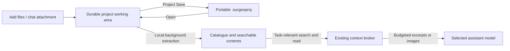

# Project Files — product and engineering specification

Status: original implementation baseline, reviewed against ouRGeo 1.16.22
(`02d1d16`) on 16 October 2026. See the
[delivery record](project-files-implementation.md) for the implementation and its
verification evidence; the baseline requirements below are retained for review.
The owner has chosen to require a saved, named project before importing files.
Linux is the initial verification platform; native Windows and macOS verification
is explicitly deferred until suitable machines are available.

**MUST** identifies a delivery requirement; **SHOULD** identifies a default that
may change with recorded evidence. Numerical limits below are proposed product
limits and acceptance targets, not measured results. Implementation milestones
are dependencies, not independent claims that the whole feature has shipped.

Reading guide: sections 1–2 explain value and scope; 4–7 describe the user
experience; 8–12 define retrieval and engineering contracts; 13–15 cover delivery,
verification and decisions. All new behaviour below is proposed until implemented.

## 1. Second assessment and recommendation

Implement Project Files as a core desktop capability. Its strongest value is
keeping the evidence and requirements for a spatial analysis with the work:
reports, methods, figure examples, specifications and supporting spreadsheets.
The assistant can discover and consult those materials without the user repeatedly
finding and pasting them. People can organise, inspect and export the same library
without using AI at all.

This is a substantial feature rather than a small attachment button. Dependable
archive saving, document extraction, source citations and model image support are
the main engineering costs. A file manager that stores documents but leaves the
assistant guessing about their contents would deliver only part of the value.

Retain the design discussed with the owner:

- Original files travel inside the compressed `.ourgeoproj` project.
- A recoverable local working area supports efficient reads and pending changes.
- A local catalogue and content index support discovery; the context broker sends
  only relevant descriptions and bounded evidence to the assistant.
- A Project Files pane and the chat's Add files control share one library.
- Automatic incremental indexing is complemented by a manual reindex action.
- Documents remain project evidence. They do not automatically become memories.

The second review adds four necessary refinements. None changes the embedded
project-library model:

1. **Named projects first — owner decision.** Scratch offers a save-first route;
   it does not acquire a second, durable document library or new exit semantics.
2. **Protect older-version compatibility.** Projects containing this feature use
   a new manifest version so older writers cannot silently strip their files.
3. **Make image delivery real.** The current chat message contract is text-only.
   Figure interpretation requires typed image evidence and transport capability
   checks; a filename or generated caption is not proof of visual inspection.
4. **Make ordinary indexing independent of AI.** Local extraction and factual
   descriptions work without a model call. Optional AI descriptions are explicit,
   accounted operations and never prerequisites for using the library.

Do not replace ZIP with a different project format for this feature. The main
benefit is a portable, reproducible project snapshot. Large, frequently edited
external datasets are a different workflow and remain outside this release.

## 2. Outcomes and scope

The delivered feature MUST support these end-to-end outcomes:

1. Add a report and figure example, save, move the bundle to a clean application
   profile, reopen it and export byte-identical original files.
2. Ask a question whose answer occurs deep inside a document. The assistant finds
   the passage and links its answer to the file and location it actually read.
3. Ask an unrelated question. No new project-file body is fetched or added by
   library retrieval, and the prompt does not grow with the number of files in
   the project. Previously delivered evidence follows conversation compaction.
4. Replace a document, exclude it from assistant access or switch projects. Old
   references cannot return new content under an old identity or leak across scopes.
5. Use the library without an AI account, an R connection or internet access.

Release scope includes original-file storage, organisation, metadata, previews,
text retrieval for Markdown/text/PDF/DOCX/XLSX/CSV, image previews and on-demand
visual evidence for qualified model transports. Legacy Word/Excel formats and
other file types may be stored and exported with explicit support status.

Out of scope: editing original Office/PDF documents in place, Office rendering
fidelity, formula recalculation, macro execution, live folder synchronisation,
external-file links, collaborative merging, automatic whole-library model ingestion,
automatic memory creation, mandatory embeddings, automatic OCR and general disk
browsing by the agent. A future OCR capability must have its own local processing,
cost and provenance design. User-authored R and terminal capabilities keep their
existing permission model; this feature does not grant them new access.

## 3. Current implementation and integration basis

| Existing component | Observed behaviour | Required integration |
| --- | --- | --- |
| [`electron/main/ipc.ts`](../electron/main/ipc.ts) | Builds a complete ZIP with `adm-zip`; writes it synchronously to a staged path and renames it. The loader accepts manifest version 1. | Move bundle I/O and verification off the main event loop; add bounded file entries, version migration and safe publication. |
| [`project-persistence.ts`](../src/lib/project-persistence.ts) | Collects R/UI/chat/memory state; queues project transitions; Save As forks project identity. | Include a consistent library revision; preserve dirty changes made during a save; carry files and references through forks. |
| [`context/broker.ts`](../src/lib/context/broker.ts) | Owns opaque references, scope, exclusions, budgets and revision checks. Search primarily ranks source descriptors. | Add local content search as a discovery input; retain broker control over every returned excerpt and image. |
| [`context/folder-sources.ts`](../src/lib/context/folder-sources.ts), [`context/folders.ts`](../electron/main/context/folders.ts) | Explicit local folder sources expose bounded UTF-8 text reads, with freshness and scope checks. | Reuse source conventions. Embedded binary documents need a distinct managed-file adapter and extractors. |
| [`ContextAttachments.tsx`](../src/components/ai/ContextAttachments.tsx) | Stages current workspace references; reads them at send time; currently limits selection to three sources. | Add project-file references and import entry point, retaining existing attachment choices and budget enforcement. |
| [`store/ai.ts`](../src/store/ai.ts) | `ChatMessage.content` is text; transport-specific state and context accounting already exist. | Add portable file references and typed visual evidence without persisting encoded binaries in chat JSON. |
| [`layout/panel-meta.ts`](../src/lib/layout/panel-meta.ts), [`layout/model.ts`](../src/lib/layout/model.ts) | Console and Terminal share the default bottom tab group; placement is user-configurable. | Register a movable, single-instance Project Files panel with an integrated group tab strip. |
| [`UnsavedChangesDialog.tsx`](../src/components/project/UnsavedChangesDialog.tsx) | Named projects prompt for unsaved work; scratch bypasses the prompt. | Existing named-project save/discard flow includes library edits. Import remains unavailable until a named project has been saved. |

This belongs in core because it participates in project identity, archive commit,
disclosure authority, chat persistence and panel layout. Extractors should still
have a small internal adapter interface so formats can be added without changing
the storage or broker contract.

## 4. Project Files pane

### Placement and navigation

- Register panel ID `projectFiles`, label **Project Files**, with one instance.
  On a fresh layout, tabs read **R console | Terminal | Project Files** in the
  bottom group. The Console remains the initially selected tab.
- Use the existing drag, resize, split/tab and layout persistence mechanisms.
  Include the group tabs in the pane header, as Console and Terminal do, avoiding
  a second redundant header. Follow the existing design tokens and typography.
- Existing layouts receive the new panel once, adjacent to Console/Terminal in
  the Console's current zone. Preserve the active panel and existing zone mode.
  If the user deliberately uses a split layout, retain it rather than changing
  every panel in that zone. Reset layout restores the default tabbed arrangement.
- Once the panel has a saved placement, reopening the application or project MUST
  respect it. Neither imports nor terminal placement settings may move it back.
- Provide **Project Files** in the existing project menu so a hidden pane can be
  reopened. Closing the pane does not remove files or stop an already requested job.
  The library remains owned by the active project, independent of pane mounting.

### Contents

The header contains **Add files**, search, and an overflow menu with **Reindex
project files**. A compact footer reports file count, original-file size and
pending-save state. A blank named project explains: "Keep reports, standards and
examples with this project. Add files to make them available when needed."

Use a sortable, virtualised file list with Name, Type, Description and Status;
size and modified/imported date belong in details or optional columns. Support
multi-selection, keyboard navigation, logical folders and filters for role,
processing status and assistant availability. Logical folders organise the
library; moving a file between them does not alter its original bytes or identity.

Selecting a file opens a details/preview area. A narrow pane uses an accessible
details view with Back navigation rather than squeezing unreadable columns.
Core actions are Preview, Attach to chat, Rename, Edit description, Change role,
Move, Replace file, Export original, Remove from project and Reindex selected.

Show persistence and processing as separate states. Examples:

- **Added · Not saved** / **Saved in project** / **Saving…**.
- **Searchable** / **Indexing…** / **Partly searchable** / **Preview only** /
  **Stored only** / **Needs password** / **Could not index**.
- Details explain the exact limitation and recovery action. Successful storage
  MUST NOT be reported as successful extraction or understanding.

Assistant availability uses the existing context-source exclusion system. The
details view explains that excluded files remain in the project and can be
previewed/exported by the user. Ordinary search results from the assistant omit
excluded filenames and descriptions as well as bodies.

All controls MUST work without hover; provide focus indicators, accessible names,
keyboard equivalents, announced progress and text contrast of at least 4.5:1.
Use British-English interface text and existing dialog/menu patterns.

## 5. File and chat workflows

### Save-first import

1. In scratch, Add files or a drop on the file/chat import target presents
   **Save project to add files**. This is the owner-selected prerequisite.
2. A user gesture may open the normal Save As dialog. Import starts only after
   project save succeeds and the destination project identity is committed.
3. Cancelled or failed save imports nothing. A dropped selection may be held as
   short-lived references for this flow, but its bytes are not copied or indexed
   before save succeeds. Project switches invalidate that selection.
4. In a named project, accept native multi-file selection or drag-and-drop. Copy
   selected regular files into managed staging, calculate content hashes and
   commit catalogue entries to the recovery journal before reporting **Added**.
5. Index independently in the background. File additions mark the project dirty.
   **Added** means recoverable locally; **Saved in project** follows archive commit.

Imports use project-wide limits in section 12. A batch shows per-file outcomes;
successful files remain added if another fails. Cancel stops remaining work and
reports what completed. A partially copied file is never published as complete.
The source on disk is not moved. Changing it later does not change the embedded copy.

The same bytes already present select the existing file and report **Already in
project**; they do not create a duplicate by default. Distinct bytes with the same
display name receive a visible disambiguated name. Replacement is an explicit
action, never an inference from a matching filename.

### Attach from chat

Extend the existing attachment area with **Add files** and **Choose project files**.
Keep its layer, document and console choices. Imported files appear in Project
Files immediately, and selected references are staged for the current message.
Removing an attachment chip removes that message's reference, not the library file.

Retain the existing three-source per-message limit initially, shared across all
attachment types. Importing more than three files is allowed. If a batch exceeds
remaining attachment slots, open the selection view to choose which to attach;
do not silently pick the first files. Each chip names the file and any selected
page, section or sheet/range. Opening the chip shows its source in Project Files.

Sending a message does not send whole files by default. For each explicitly
attached document, deliver a bounded description/outline and task-relevant
excerpts; the agent can read further through context tools. A selected range
takes precedence over automatic excerpt selection. Image attachments use the
visual-evidence path in section 8. If extraction is incomplete, the composer
identifies this and offers to wait or send the available metadata; it never
claims missing content was attached. Blank text with attachments gets a clear
"Add a message describing what you want to do with these files" prompt.

Library availability, message attachment and actual model disclosure are distinct:
the first makes a source discoverable, the second expresses relevance to this
turn, and the context inspector records what was actually sent. A cloud provider
receives selected content under the existing assistant disclosure settings;
import alone initiates no provider upload.

### Replace, export and remove

Replacement keeps the logical file ID, increments its content revision and
invalidates readers/indexes/attachment selections for the old bytes. Preserve
user descriptions, folder and role; identify them as needing review after content
changes. Keep the current file intact if replacement import fails.

Export original writes exact original bytes through the existing save workflow.
The preview is read-only. To edit in another application, export, edit and use
Replace file; the product makes this explicit instead of implying automatic
external edit synchronisation. Importing data into R or creating a new editable
ouRGeo document is a later action, not a side effect of adding a reference.

Remove immediately revokes retrieval and removes the item from the working
catalogue. Offer an Undo action until save or project transition; removing a
logical folder acts on its listed contents, with a clear multi-file confirmation.
Removed bytes remain only where needed for Undo or the last saved bundle until a
successful save/discard resolves them. Removing a file does not edit old answer
text or delete the source file originally imported from disk.

## 6. Supported content and honest interpretation

| Format | Preview | Search/read contract | Limits visible to users |
| --- | --- | --- | --- |
| Markdown, UTF-8 text and source text | Read-only text/Markdown with line navigation | Headings and exact bounded line ranges | Unsupported encodings require an explicit conversion; scripts are never executed during import. |
| PDF with a text layer | Rendered pages | Page-aware text, headings where reliable, cited page indices | Columns/tables may have imperfect reading order; rendering a selected page is available for visual inspection. |
| Scanned or mixed PDF | Rendered pages | Existing text layer only; per-page coverage | Image-only pages are labelled; no silent OCR or claim of full-document search. |
| PNG, JPEG, WebP | Image with dimensions, zoom and pan | File metadata; optional typed visual evidence on demand | Text-only models cannot inspect appearance. A caption does not replace image delivery. |
| DOCX | Structured text, headings, lists and tables | Section/paragraph/table-cell locations | No promise of Word pagination or exact layout. Unsupported embedded objects are identified. |
| XLSX | Sheet selector and bounded grid | Sheet names, populated regions and exact cell/range reads | Preserve raw value, type, displayed text, number format and formula where available. Cached formula results may be stale; no recalculation. |
| CSV/TSV | Bounded grid and raw text | Header/row/column locations, strings preserved | Expose detected delimiter/encoding; preserve leading zeros and avoid guessed date conversions. |
| DOC, XLS, encrypted Office files, other types | Basic metadata or a supported safe preview | Stored-only unless a separately qualified adapter exists | Export/reimport a supported format. Password-protected content is retained but not indexed in this release. |

PDF citations use the physical page number and the document's printed label when
available. DOCX citations use structural locations, never invented page numbers.
Spreadsheet reads preserve sheet names, merged-cell information, blank versus
missing cells and date-system metadata. Search default excludes hidden sheets,
rows and columns; the preview identifies their presence and the user can explicitly
include them. Changing that selection invalidates related index results. Workbook
notes warn that a displayed date or cached formula is an interpretation of the
stored value; derived calculations still require visible, authorised computation.
Apply this selection to model-visible descriptions and snippets as well as reads;
hidden content cannot leak through an automatically generated summary. Human
preview controls can reveal it without implicitly authorising assistant disclosure.

Each extractor reports covered locations and omissions. A parser that reads the
first portion of a file must return **Partly searchable**, with exact coverage,
rather than **Searchable**. Negative answers must acknowledge incomplete coverage.
Optional/embedded relationships never cause network requests or reads of arbitrary
local files. HTML/Markdown previews disable active content and remote resource loads.

## 7. Catalogue, descriptions and reindexing

Each library entry has a stable ID, original filename, editable display name,
logical folder, detected media type, byte length, SHA-256 content hash, content
revision, import/update timestamps and a role: **Reference**, **Standard** or
**Example**. Reference is the default. Generated metadata records its extractor
version, source hash, extraction coverage and provenance.

Keep user descriptions and generated descriptions in separate fields. A user
description takes display precedence and survives reindexing. Initially generate
a short factual description locally, using title, headings, page/sheet count and
other verified structure. For an image without such text, report dimensions and
type rather than inventing its contents. Descriptions are discovery aids; claims
about requirements, measurements or facts need source reads.

An optional **Describe with AI** action can generate a richer description with a
capable selected model. Show its scope and estimated use through existing budget
controls; send only chosen evidence and record coverage, model and source revision.
Do not silently switch providers or run this action on every import. Preserve a
user description when an AI description is regenerated. Failure leaves local
indexing and original-file access usable. This action is optional delivery scope.

Automatic indexing occurs after import/replacement and when the extractor version
changes. Stable hashes allow unchanged work to be reused. **Reindex project files**
checks integrity, rebuilds stale/missing content indexes and regenerates factual
descriptions for the selected scope. An advanced **Rebuild all** option replaces
all derived indexes. These operations do not overwrite user metadata or launch AI
description jobs. Provide progress, cancellation and a per-file result report.

Build a new index generation separately and publish it atomically. Keep a valid
old index for unchanged bytes while rebuilding. Changed bytes never use an old
index as if current. Index failures retain originals and name the recovery move.
Index-only rebuilds do not mark project content dirty; a changed portable
description does. Reindexing can be resumed after interruption.

## 8. Context, retrieval, images and citations

### Discovery and reading

Add project files to the existing broker as project-scoped document sources,
grouped as `project-files`. Use project-qualified identities; absolute paths and
archive entry names are never model-controlled read authorities.

Keep a bounded library availability hint in the scope card, such as authorised
file count and indexing availability. Do not list the whole catalogue or pin all
standards into every prompt. Project-wide instructions the user explicitly wants
always applied continue to use the existing pinned memory mechanism.

`context_search` MUST query both descriptions and local extracted content. Merge
and deduplicate ranked hits, returning bounded snippets with source locations,
revisions, match reasons and coverage. Local lexical full-text retrieval is the
baseline; embeddings and external memory providers are not dependencies. A match
inside page 80 must be discoverable even if no description mentions its terms.
Include list/browse fallback so a failed keyword match is not mistaken for absence.

Extend `context_read` with validated location selectors while preserving its
existing line-range interface. Locations are discriminated types: text lines,
PDF page/range, DOCX section/paragraph/table range, sheet cell range, or image.
Reject incompatible/mixed selectors. Opaque references/cursors bind to file ID,
content revision, extraction revision, project lease and disclosure revision.

Every read returns title, revision, location, coverage, content type and
completeness, plus a continuation cursor when appropriate. Recheck authority
after asynchronous work and immediately before dispatch. Explicit attachments
receive context budget before optional prefetch, under the existing broker limits.
On small model windows, give recoverable smaller reads rather than dropping
attachments or truncating user instructions.

Cache extracted contents locally by hash and extractor version; cache retrieval
results by source revision, range and disclosure scope. Reusing disk data does not
justify claiming that the model remembers it. Build every invocation according to
the existing transport's context semantics and budget all repeated evidence.
Older completed excerpts may be compacted to findings plus source references;
re-read the original when a later claim needs details. Preserve tool-call pairing
and existing provenance/disclosure filtering during compaction.

"No loading on unrelated turns" means no fresh library retrieval or repeated
catalogue injection. A conversation may still contain previously supplied file
evidence. Measure that retained cost separately; do not claim zero document tokens
merely because the file was not read from disk again.

### Images and rendered PDF pages

Introduce typed image evidence between the broker and provider transports. It
contains an authorised file/page reference, revision, dimensions and bounded
rendition metadata. The host materialises bytes only at dispatch. Do not put
base64 in source descriptions, tool text, persistent chat JSON or `project.json`.
Binary encoding in a provider request is transient and is not persisted as chat.

Maintain model/transport capability states **supported**, **unsupported** and
**unknown**. Enable delivery only for a qualified combination. Test image
serialisation, budget accounting, provider/model switches, cancellation and
retained-session replay separately for each enabled transport. Never silently
discard an image or send it as a path inaccessible to the model.

For unsupported/unknown combinations, show a precise limitation and retain the
attachment's metadata. Offer the existing model selector; changing models remains
the user's choice. Report "Image not inspected" in evidence status. Downsampled
images identify their dimensions and completeness; a request for a crop or higher
resolution goes through the broker again. Do not make fine-detail claims from an
unreadable rendition. Image usage participates in pre-dispatch budgeting, with
conservative estimates and explicit uncertainty where exact accounting is absent.

The release MUST qualify at least one usable image-capable transport/model path
with available resources before claiming visual-reference support. Other paths
remain explicitly unsupported/unknown until tested. Local/offline document
storage and text retrieval work regardless of that capability.

### Evidence and instructions

Answers based on project documents cite clickable file locations. Clicking opens
Project Files at the location, respects the user's pane placement and restores
keyboard focus appropriately. Save portable citation records with project/file
identity, source revision and locator; live opaque handles are not portable.

Replacement or removal leaves old citations labelled **Earlier version** or
**File removed**. Never resolve an old citation silently to new bytes. This release
does not retain a complete portable version history; if old bytes are unavailable,
state that and offer the current file as a separate navigation action.

The context inspector shows which excerpts or renditions were actually sent,
their locations, completeness and estimated/reported usage. Selection alone is
not evidence of delivery. A Standard role helps find likely requirements; it does
not turn document text into privileged instructions or automatically establish
legal/regulatory compliance. Conflicting sources should be identified and cited.

## 9. Storage and project lifecycle

### Portable representation

Use separate archive entries for originals and a versioned catalogue:

```text
project.json                         # existing project state, manifest v2
environment.RData                   # existing optional R snapshot
context/project-memory.jsonl         # existing project memory
files/catalogue.json                 # library schema v1, entries and metadata
files/blobs/<sha256>                  # exact original bytes, one per unique hash
```



Manifest v2 references the library schema and catalogue revision. Each entry
references its blob hash and size. Internal paths are generated by the host;
display names and logical folder names never become extraction paths. Store
originals as bytes, not encoded JSON. Do not nest ZIPs created solely to wrap
individual files; DOCX/XLSX originals remain their native bytes. Avoid recompressing
already compressed formats where the measured size saving is negligible.

Portable data includes user descriptions, roles, generated factual descriptions
and their provenance. Machine paths, provider session IDs, authorisation tokens,
transient retrieval handles, thumbnails and full-text indexes stay local. Opening
on another machine can list files immediately and rebuild searchable contents in
the background. Bundled descriptions are untrusted until validated; they never
prove a particular page or cell was read.

### Durable working area and rebuildable caches

Separate pending original-file changes and their catalogue journal from disposable
derived previews/indexes. A cache eviction must never remove the only copy of an
unsaved import. Commit imported bytes before acknowledging their catalogue entry;
uncommitted staging files are recognisable and can be cleaned after interruption.

Journal mutations serially, keyed by project identity, bundle base revision and
library revision. Use the existing persistence transaction conventions rather than
overlapping renderer read-modify-write IPC. Store originals in private application
directories with restricted permissions; bundles remain ordinary readable project
files. Derived searchable text follows the existing protected-context storage/key
policy, including encrypted persistence and bounded in-memory search indexes.
If protected storage is unavailable, retain originals and local human previews,
but pause protected indexing/AI access with a recovery message. Do not downgrade
to an unprotected disk index or claim that a readable project archive is encrypted.

Crash recovery offers the pending changes only to the matching project/base
revision. If the bundle changed elsewhere, preserve the draft and offer recovery
to a separate copy instead of merging or overwriting silently. The app's normal
scratch startup may show a recoverable-project notice; it must not import that
project's files into scratch or another project's context.

### Save and cancellation

1. Use the existing serial project operation queue. Freeze a library snapshot and
   retain its referenced blobs; changes after the snapshot stay dirty/journalled.
   Preserve all other project entries. If R is unavailable, a file-library save
   carries forward the last committed R snapshot and explicitly reports that it
   was retained, rather than silently removing it. A successful new R snapshot,
   including an intentionally empty environment, replaces the previous one.
2. Read and write entries incrementally in background workers. Neither the main
   process nor renderer may buffer the whole archive or run synchronous compression.
3. Stage the complete bundle in the destination directory. Check available space
   for originals, the new archive and retained last save; report progress and a
   cancellable stage before publication. Free-space checks supplement actual I/O
   error handling and do not guarantee a later write will succeed.
4. Reopen/validate the staged archive, catalogue and referenced blob sizes/hashes.
   Missing or corrupt content blocks publication. A missing file cannot silently
   become a smaller successful project save.
5. Recheck destination/base revision, project authority and cancellation. Flush
   files and use atomic replacement on the same filesystem, with parent-directory
   durability where supported. A locked destination or unsupported replacement
   fails without deleting the last good save. An external-change conflict offers
   Save As rather than overwriting a newer project.
6. Only after publication mark the saved snapshot committed and release obsolete
   staging. An edit arriving during save remains dirty. Cancellation after the
   commit point reports that saving completed rather than pretending it was undone.

Do not repack on each chat, metadata lookup or background index update. Normal
project Save is the portability boundary; local recovery protects changes between
saves. Reflect file changes in the existing named-project save/discard prompt.
Discard restores the committed library and revokes draft references. A failed save
or cancelled Save As leaves originals, journal and the previous bundle available.

Save As follows existing project forking rules. Preserve logical file IDs within
the new project namespace, copy/rebind portable citations and reset live handles
and transport delivery state. The source project remains independent. Duplicate
bundle detection and imported local-policy handling use the existing mechanisms.

### Compatibility

New readers MUST open legacy v1 projects with an empty library. Saving an unchanged
legacy project need not upgrade it. The first committed library data or project-file
chat/citation references upgrade the manifest to v2; later saves retain v2 even if
the library becomes empty.
Older ouRGeo versions already reject unknown manifest versions, preventing the
current v1 packer from silently stripping library entries on resave. Show that the
project requires a version supporting Project Files in compatibility information.

Unknown future library schemas or required capabilities block writable opening;
do not ignore unknown entries and repack a lossy project. Validate an incoming
catalogue and archive structure before resetting the current R/UI project.
Recognised bundles with damaged file bodies may open in a clearly labelled
recovery mode, with healthy originals exportable and overwrite-save disabled.
Verify hashes before extraction, use or export; saving verifies every referenced
blob. An index cannot substitute for missing original bytes.

## 10. Authority, privacy and failure handling

The main process owns file import authority, library mutations and blob lookup.
Renderer IPC carries project lease, operation ID and expected revision; it cannot
assert that an arbitrary filesystem path is a project member. Only user-selected
imports and explicitly authorised app-generated files enter the library. Do not
add a broad file-reader tool to implement this feature.

Extend existing exclusion and source-revocation behaviour to file descriptors,
indexes, cached results, image renditions, retained provider sessions and future
prompt reconstruction. Checks apply before and after awaits. Switching projects,
deleting/replacing a file or revoking its access cancels affected in-flight work;
late results cannot attach to the next project/chat. Previously transmitted content
cannot be recalled from providers; historical citations remain honestly labelled.
Per-file disclosure choices remain protected local policy, consistent with current
context exclusions, rather than permissions asserted by a portable archive.

Library import never automatically ingests documents into Mnemosyne, Hindsight or
another memory service. Basic extraction and search require no network, model,
R package or external office application. Reuse existing trace/accounting rather
than adding a second context history.

Treat archive/document parsing as a bounded workload: reject path traversal,
absolute entry paths, links, duplicate/conflicting archive entries and false size
claims; enforce actual decompressed-byte limits, including nested Office parts.
Use supervised parser workers with time/memory limits and no inherited credentials.
Configure parsers/previews to prohibit external relationships, executable content
and network access. A worker thread alone is not a security sandbox; select process
isolation where needed to enforce the parser's resource and access contract.
Cancellation and worker crashes preserve original files and return recoverable status.

The console/activity output records meaningful import, replacement, export, removal
and reindex outcomes. File housekeeping has no R equivalent, so log descriptive
events rather than inventing R. Any later action that performs analysis or loads
data into R must use the existing shared controller and echo its actual R.

AI navigation/list/preview actions use the existing `always` tier; catalogue/file
mutations and exports follow `autopilot`, and destructive replacement/removal uses
`confirm`, subject to current user overrides. AI actions never open native file
pickers. They operate on authorised file references; if a new source must be chosen,
they direct the user to Add files. Direct user gestures retain normal GUI behaviour.

## 11. Proposed implementation boundaries

| Area | Work |
| --- | --- |
| Main-process library service | New focused `electron/main/project-files/` modules for catalogue/journal, import, blob storage, validation and operation coordination. Main-issued leases remain authoritative. |
| Bundle service | Extract packing/unpacking from the large IPC handler into a worker-backed module shared by existing state and new file entries. Preserve memory commit/fork ordering. |
| Extraction service | Versioned adapters with `inspect`, `extract` and bounded `read`; supervised jobs with coverage, progress and cancellation. Render previews separately from text extraction. |
| Renderer library state | A dedicated store with immutable catalogue snapshots, selection/filter state and operation progress. Components consume it rather than owning file lifetime. |
| Pane and chat | `ProjectFilesPanel`, project-menu entry, attachment selectors/chips and shared preview navigation. Register assistant targets with `data-ourgeo-id`. |
| Context | Project-file source adapter, local content search, typed locations/evidence, attachment budgeting, invalidation and inspector integration. |
| Model transports | Typed image serialisation and capability checks for each enabled route; preserve text-only paths and existing usage authority. |
| Persistence | Manifest v2, portable citation/reference migration, recovery/snapshot protocol, dirty tracking and Save As scope handling. |
| Documentation | Update architecture, user-facing README, `ourgeo_docs` project/context guidance and release material when implemented; distinguish qualified from deferred capabilities. |

Evaluate PDF.js for page rendering/text extraction, Mammoth or a qualified
structural DOCX reader, SheetJS CE or a qualified workbook reader, and bounded
streaming ZIP readers/writers. These are candidates, not approved dependencies or
version pins. An implementation spike must confirm licence compatibility, current
security/maintenance status, Electron packaging, memory behaviour and fixture
fidelity, then pin the chosen versions. Avoid a mandatory Python/Office runtime.
Mammoth-generated HTML requires sanitisation and external file access must remain
disabled. A DOCX adapter that loses source locations does not meet this spec.

## 12. Limits and responsiveness

Initial product limits are 2,000 library files, 100 MiB per original and 1 GiB total
original-file bytes per project library. These apply to library content, not as a
new cap on the pre-existing R snapshot. Import preflight explains exceeded limits
and permits the remaining valid selection. Library archive validation enforces
the same limits against actual output; embedded Office archives have their own
bounded expansion checks.

Initial extraction ceilings: 2,000 PDF pages, 100,000 populated spreadsheet cells
per workbook, 20 MiB extracted text per file and 250 MiB derived text per project.
A file exceeding extraction limits may still be stored within original-file
limits; expose exact partial coverage and provide bounded on-demand reads when
safe. Per-read budgets, parser RSS limits and timeouts are fixed in the adapter
contract after the dependency spike, before full-format implementation. They must
not depend on a file's claimed dimensions or compressed size alone.

Use at most two background extraction jobs by default, with explicit reads ahead
of background reindexing. A stalled job must terminate or checkpoint; it cannot
block project navigation or unrelated chat. Run save/verification separately with
bounded memory and coordinated disk access.

Measure a reference workload of 250 files / 250 MiB originals and a synthetic
catalogue at the 2,000-file limit. Record hardware, cold/warm cache state and corpus.
Proposed acceptance targets: warm pane opening within 300 ms; warm indexed search
p95 within 500 ms; immediate progress feedback within 200 ms; cancellation feedback
within 250 ms and worker quiescence within 2 seconds at a supported boundary.
The feature must introduce no repeated main/renderer event-loop stalls above
100 ms during import/index/save. Long compression/verification may take time but
must remain observable and cancellable before commit.

An unrelated prompt adds no new file-derived body tokens through retrieval and at
most 100 tokens of constant-size library capability information, independent of
file count. Measure retained transcript evidence separately. Relevant
reads share existing per-turn budgets rather than adding an unbounded separate
allocation. Record end-to-end retrieval quality and total model use; merely making
the first prompt small is not success. If targets fail, correct the bottleneck or
revise documented supported limits with evidence; do not report unmeasured targets
as passed.

## 13. Delivery sequence

1. **Storage and compatibility:** named-project gate, library schema, durable import,
   safe worker-backed save/open, v1 migration/v2 rejection, Save As and crash recovery.
   Prove original-byte preservation before building rich previews.
2. **Pane and chat integration:** default Console/Terminal tab placement, persistence,
   catalogue operations, logical folders, attachment references and source navigation.
3. **Text evidence:** local extraction/search for text/PDF/DOCX/XLSX/CSV, bounded
   locations, citations, reindex coverage and exclusion/freshness behaviour.
4. **Visual evidence and format completion:** image/PDF preview, qualified image
   delivery, truthful unsupported paths, retained-context/usage integration.
5. **Linux acceptance and documentation:** real packaged/dev application flows,
   failure injection, performance results, regression checks and an explicit
   Windows/macOS deferral record.

Each step should leave an independently reviewable implementation and evidence.
An early storage-only build may be used during development, but must not be
advertised as the completed project-aware assistant feature. Optional AI-generated
descriptions, OCR, semantic search and external links are follow-on work and must
not delay the required local library and retrieval path.

## 14. Verification and acceptance

The implementing agent owns fixtures, automated tests, application verification
and defect correction. Do not request external testers, a third-party audit or
owner acceptance testing as routine delivery gates. Ask the owner to test only
when a specific necessary check cannot be performed with available tools/hardware,
after documenting the attempted method and limitation. Native Windows and macOS
checks below are already deferred and do not require repeated requests for machines.

Use self-authored deterministic fixtures with independent expected bytes, passages,
page locations and cell values. Do not use private project files as fixtures. Run
the repository's typecheck, lint and relevant tests, then the required complete
suite for the integrated change. Visual changes require Playwright-driven checks
and inspected screenshots in the real Electron app using an isolated profile.

| ID | Acceptance scenario | Required evidence |
| --- | --- | --- |
| PF-01 | Import/save/reopen/export every supported original type in a fresh profile | SHA-256 equality, portable catalogue and citations; no dependency on original disk paths or old caches. |
| PF-02 | Add files from scratch; cancel/fail Save As, then save successfully | No import before committed named-project creation; successful import belongs to the new identity. |
| PF-03 | Initial and migrated layouts; drag elsewhere; restart/reset | Correct default tabs, preserved active pane/custom split mode, remembered moved placement, working reopen route. |
| PF-04 | Chat import and existing-file attachment; more than three imports; chip removal | Single shared library, explicit attachment selection, persistent file after chip removal, no whole-file silent upload. |
| PF-05 | Answer appears only on page 80, inside a DOCX table or in a non-first workbook sheet | Content search finds independently specified text/cells; reads and clickable citations identify correct locations. |
| PF-06 | Unrelated chat against empty, 250-file and 2,000-file catalogues | No turn-triggered body reads/index rebuild/provider ingestion; new prompt increment meets constant-size target, with retained transcript evidence measured separately. |
| PF-07 | Multi-column/mixed scanned PDF, unusual DOCX structure, dates/formulas/leading-zero cells | Correct expected values or visible partial/unsupported coverage; no invented pagination, recalculation or full-coverage claim. |
| PF-08 | Figure/PDF-page attachment on supported and unsupported models | Actual typed image bytes on supported route; image-inspection task grounded in the fixture; clear limitation and no silent image loss elsewhere. |
| PF-09 | Replace/remove/exclude during search, extraction, model dispatch and save | Old references rejected or labelled historical; no stale late result, scope crossover or revoked payload delivery. |
| PF-10 | Switch project, same names in two projects, Save As and duplicate bundle copy | Project-qualified identities, correct citation rebinding, independent edits/policies and revoked transport handles. |
| PF-11 | Crash after copying, journalling, staging or publication; disk full; locked destination; R unavailable | Recoverable acknowledged imports, intact previous save, accurate commit result, retained last R snapshot when appropriate and no partial "success". |
| PF-12 | Edit during save; external bundle replacement; cancel before/after commit | Later edits remain dirty; conflict does not overwrite; cancellation reports correct publication state. |
| PF-13 | Open v1/v2/future-version/corrupt bundles; resave with legacy reader | v1 opens, old reader refuses v2, unknown schema is not rewritten, damage does not silently remove originals. |
| PF-14 | Reindex changed/unchanged files, cancel, restart, parser upgrade, user description | Incremental reuse, preserved user metadata, complete generation publication and correct coverage/failure reports. |
| PF-15 | Duplicate names/bytes, Unicode/case differences, oversized and adversarial archives | Deterministic import results, safe internal paths, real size bounds, worker termination and original preservation. |
| PF-16 | Offline import/preview/search with no R or model; protected key unavailable | Local library usability, no unintended network calls, explicit paused protected indexing/access rather than plaintext fallback. |
| PF-17 | Narrow/wide pane, keyboard-only operation, themes, many files | Usable details view, accessible controls/focus, measured contrast, virtualised list and responsive navigation. |
| PF-18 | Long conversation with repeated/replaced references; small context window | Bounded whole-invocation payload, accurate compaction/provenance, valid tool pairs and explicit overflow recovery. |

Mocked provider tests MUST inspect exact serialised text/image payloads. They do
not establish model comprehension. Run a small real-model task set using available
configured local or authorised provider resources: locate a deep report requirement,
read precise spreadsheet cells and describe a self-authored figure. Compare answers
with fixture expectations and inspect citations. If a required real-model path is
unavailable, record that specific unresolved gate rather than claiming mocked tests
qualified it or asking for broad outside testing. No new paid service is a
prerequisite for storage/text-index verification.

On Linux, verify both `npm run dev` and a packaged application with isolated data;
exercise file dialogs, drag-and-drop, reopen and worker resources. Check existing
project memory, chats, attached folders, R save/load, database reconnect and
Console/Terminal behaviour for regressions. Record results in a separate
`project-files-implementation.md` delivery record when implementation begins.

Deferred native checks:

| Platform | Checks to perform when hardware is available | Release treatment |
| --- | --- | --- |
| Windows | Drive/UNC/long paths, Unicode and case collisions, file locks/antivirus interference, atomic replacement, native picker/drop, packaged workers and safeStorage. | Mark native verification deferred; Linux tests and simulated path tests do not prove these behaviours. |
| macOS | Application packaging/signing of workers, sandbox/bookmark behaviour if applicable, file access prompts, APFS/case handling, native picker/drop, keychain-backed protection and save durability. | Mark native verification deferred; do not claim macOS qualification from Linux results. |

Windows/macOS deferral does not block a clearly scoped Linux delivery. Any platform
fixes found later must preserve portable archive compatibility and run the shared
regression suite.

## 15. Decisions, remaining engineering work and evidence sources

Product decisions established for this spec: embedded originals; local working
area; existing broker integration; default Console/Terminal tab placement; movable
pane; manual plus automatic reindexing; named-project requirement before import;
agent-owned Linux testing and explicit native Windows/macOS deferral.

No further owner decision is required to develop against these requirements.
Dependency selection, measured parser budgets and qualified image transport/model
combinations are implementation findings to record. A proposal to change storage
format, silently omit a requested format from the declared release, add mandatory
cloud processing or alter the named-project prerequisite is a significant design
change and should return to the owner with evidence and alternatives.

Primary technical sources checked for this specification:

- PDF.js documents page rendering and text extraction through its display/core
  APIs: [examples](https://mozilla.github.io/pdf.js/examples/index.html) and the
  [Node text extraction example](https://github.com/mozilla/pdf.js/blob/master/examples/node/getinfo.mjs).
- Mammoth documents DOCX conversion, external file access controls and the need
  to sanitise generated HTML: [upstream documentation](https://github.com/mwilliamson/mammoth.js).
- SheetJS documents parsing options for formulas and date values. Those options
  need deliberate adapter choices and fixture checks:
  [reading files](https://docs.sheetjs.com/docs/api/parse-options/).
- Yauzl documents lazy entry reading and declared/actual size validation, useful
  building blocks rather than a complete hostile-archive policy:
  [upstream documentation](https://github.com/thejoshwolfe/yauzl/blob/master/README.md).

Repository code links in section 3 establish the current baseline. Earlier planning
documents may describe behaviour that has since changed; implementation must
verify against the current code and preserve its scope, persistence and context
invariants. Passing this specification's review is not evidence that the feature
has been implemented or tested.
